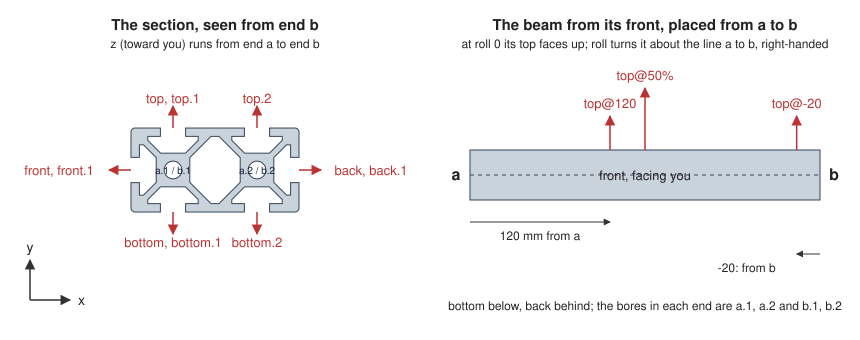

# @rulecad/frames

Structures built from beams. A beam is a length of a profile: an aluminium extrusion from any maker's spec sheet, a
plain tube or angle, or a beam printed in plastic. Part of [rulecad](https://github.com/JoniBach/rulecad), a kit for
designing physical things where every measurement says which rule it comes from.

This release reads a profile, which is everything the rest is built on, and makes beams of it:

- **`profileModel`**: a profile as a model from its rule set and its slot family's, every figure with how far to
  trust it and where it comes from, its slots, bores and hollows each in their place.
- **`outline`**: its section as closed loops, drawn from a handful of dimensions, or a measured outline where you
  have one.
- **`section`**: what that outline is worth as a beam (area, centroid, second moments, torsion constant, mass per
  metre), each beside the figure on the maker's sheet.
- **`profileFindings`**: what a check of a profile finds, as `cad rules check` reports it.
- **`beamModel`** and **`beam`**: a length of a profile, with its mass and centre of mass, the anchors an assembly
  places it and its fittings by, and its solid as a light box or the true section.

Beams in assemblies, joins that do their own drilling, fittings, slot nuts and linear guides follow in later
releases. The plan is [issue 240](https://github.com/JoniBach/rulecad/issues/240).

```sh
npm install @rulecad/frames @jscad/modeling
```

It depends on `@rulecad/rules`, where the profiles live as open data, and takes JSCAD (`@jscad/modeling`, which a
rulecad design already has) as a peer for a beam's solid.

## A profile

```js
import { profileModel, outline, section, profiles } from '@rulecad/frames'

profiles()                                  // ['profile-2020-bosch', 'profile-2020-generic', 'profile-2020-misumi-hfs5', …]
const p = profileModel('2020-misumi-hfs5')  // MISUMI's HFS5-2020, by its set's name with or without 'profile-'

p.width, p.height, p.cornerRadius           // 20, 20, 1
p.faces.top                                 // [{ face: 'top', index: 1, slot: 'slot-6-misumi', at: [0, 10], normal: [0, 1], along: [1, 0] }]
p.slots['slot-6-misumi'].opening            // 6
p.bores[0]                                  // { at: [0, 0], diameter: 4.2, thread: 'M5', threadSet: 'm5', tapDrill: 4.2, … }
p.sheet.area                                // 183: the catalogue's figure, mm²
p.figures.area                              // { value: 183, unit: 'mm²', kind: 'spec', source: 'MISUMI … page 2-529, https://…', … }
p.material.modulus                          // 69972 MPa, from the al6n01-t5 rule set the profile names

const s = section(p)
s.area, s.inertiaX, s.torsion               // 182.5 mm², 7425 mm⁴, 809 mm⁴: from the drawn outline
s.sheet.area                                // { sheet: 183, computed: 182.5, difference: -0.003 }
outline(p).loops                            // [[[x, y], …] the outside, counter-clockwise, then each hole clockwise]
```

A section is drawn in x (across, its width) and y (up, its height) with the middle of its envelope at the origin.
The beam runs along z. Its faces are `top` (+y), `bottom` (-y), `front` (-x) and `back` (+x), and the slots of a face
count from 1 along +x or +y. Lengths are in mm, areas mm², second moments and the torsion constant mm⁴, mass kg/m.

### The model

| Field | What |
|---|---|
| `kind`, `name`, `family` | `'profile'`, the set's name, and what sort of section: `t-slot`, `v-slot`, `tube`, `round-tube`, `angle`, `channel`, `bar`, `round-bar`, `custom`, `printed` |
| `series`, `cells`, `pitch` | The base size, the cells as `[across, up]`, and the size of one cell as `[x, y]` |
| `width`, `height`, `cornerRadius`, `wall` | The envelope, and a tube's, angle's or channel's wall |
| `faces` | `top`, `bottom`, `front`, `back`: each a list with one entry per cell along it, `{ face, index, slot, at, normal, along }`. `slot` is a slot family's name, or `null` where the face is closed there |
| `slots` | The slot families it uses, by name: `{ opening, mouth, lip, lipAngle, cavityWidth, cavityDepth, floorWidth, flankAngle, straight, trackWidth, trackAngle, nutFamily, figures }` |
| `bores` | Each bore: `{ at, diameter, thread, threadSet, tapDrill, major, threadPitch, where }`, `where` being `cell`, `corner` or `given` |
| `title` | A line for a list: `'25 x 25 x 2 tube, al6063-t5'`, `'20 x 20 t-slot (profile-2020-misumi-hfs5)'` |
| `chambers`, `hollows` | The closed hollow where two cells meet (`{ at, axis, width, length, depth, ends, slot }`: `ends` are its half widths toward each end, narrower toward a place where four cells meet), and square hollows in the corners of a lighter section |
| `sheet` | What the sheet says: `{ area, inertiaX, inertiaY, modulusX, modulusY, torsion, massPerMetre }`, `null` where it gives none |
| `material` | The material set it names: `{ name, alloy, density, modulus, poisson, strength, figures }`, or `null` |
| `supply` | `{ lengths, cutMin, cutMax, cutTolerance, straightness, twist }` |
| `figures` | Every rule of the set by name, each `{ value, unit, kind, source, rule, checked }` |
| `measured` | A measured outline, when one was handed in |
| `rests` | The kinds its figures and its slots' rest on: `['spec', 'estimate']` |

`profileModel(which, change, given)` takes a second argument to change a figure (`{ bore_diameter: 5 }`, or
`{ area: { value: 180, kind: 'measured', source: 'weighed a metre' } }`), and a third for what is not in the
catalogue: `{ sets: { 'my-slot': {…} } }` or `{ load: (name) => set }` for a slot family, thread or material of your
own, and `{ outline: {…} }` for a measured outline. A profile of your own is a rule set handed in place of the name.

### Cells and faces

A larger section is cells of its series. A 40 x 20 has `cells_across` 2 and `cells_up` 1 in its rule set, and the
model expands them: two slots on each wide face, one on each end, a bore in the middle of each cell and one closed
hollow where the two cells' slots would have met. Each sold profile is its own rule set with its own sheet's figures.
A face is overridden in the rule set: `"slot_bottom": "closed"` for a smooth face, `"slot_top": "slot-6, closed"` for
one slot of two, another family's name to mix two slots in one section.

A grid need not be full. `cells_absent` names the cells that are not there, as across,up pairs from 1 at the lower
left: OpenBuilds' C-Beam is 4 cells by 2 with `"2,2; 3,2"` absent. `faces` then holds a place for every side of a cell
with no cell beyond it, by the way it looks: `faces.top` of a C-beam has four places, two on top of the arms and two on
the floor of the C lower down, and `faces.back` has the inside of the left arm beside the right-hand outside. `index`
is the place's column (top and bottom) or row (front and back). Where four cells meet, or a cell stands at a corner of
a missing one, the hollows between cells keep to the cavity's own width (`ends`), so they stand clear of each other.

### Outlines

`outline(model)` returns `{ loops, measured, source }`. Each loop is a closed list of `[x, y]` points: the outside of
the metal first, counter-clockwise, with every open slot cut into it, then each hole clockwise (bores, hollows, a
tube's inside). It is drawn from the interface dimensions alone: the envelope and its corner radius, each slot from
its opening, lip, cavity width and depth, floor width and flank angle, and each bore as a circle of the same area. It
leaves out what those dimensions do not say: fillets, the notches round some makers' bores, grooves and ribs.

A measured outline takes its place when you have one: `readOutline(json)` holds a file to its format (a `source`, a
`licence`, and `loops` in mm) and turns every loop the right way round. In a workspace it is the file
`rules/outlines/<set name>.json`. The kit publishes no maker's outline. It draws its own, and a maker's model is
measured in your own workspace.

### Plain sections: a family and a size

Tube, round tube, angle, channel, flat bar and round bar have no maker's sheet. Each is a family with a base set
(`profile-tube`, `profile-round-tube`, `profile-angle`, `profile-channel`, `profile-bar`, `profile-round-bar`) that
holds a starting size, and any other size is the family's name with the figures you have:

```js
const tube = profileModel('tube', { width: 25, height: 25, wall: 2, material: 'al6063-t5' });
tube.title;                                   // '25 x 25 x 2 tube, al6063-t5'
section(tube).area;                           // 184 mm²: 25² less 21²
beamFigures(tube).torsion;                    // { value: 25410, unit: 'mm⁴', kind: 'derived', from: 'outline', source }
profileModel('angle', { width: 40, height: 25, wall: 3, material: 's275' });   // unequal legs, in steel
profileModel('round-bar', { width: 12, height: 12 });                          // a round section's width and height are its diameter
```

| Family | `width` | `height` | `wall` | Also |
|---|---|---|---|---|
| `tube` | Outside, across | Outside, up | The wall, all round | `corner_radius` outside (cold-formed steel tube is rounded by about twice its wall) |
| `round-tube` | Outside diameter | The same | The wall | |
| `angle` | The leg along the bottom | The leg up the side | Both legs' thickness | The legs meet at the lower left |
| `channel` | Across the web | The flanges' height | Web and flanges | The web is along the bottom |
| `bar` | Across | Thickness | none | |
| `round-bar` | Diameter | The same | none | |

`material` is a material set's name (`al6063-t5`, `s275`, or one of your own through `given`), and gives the mass per
metre. A few common sizes are ready sets, named for what they are (`profile-tube-al-25x25x2`,
`profile-angle-steel-30x30x3`): each is its family at that size, for a workspace that wants a name to point at.

`beamFigures(model)` gives the figures to design a beam with, whatever the profile: the sheet's own where the maker
prints one (`from: 'sheet'`, with the sheet's kind and source), and the outline's where it does not (`kind:
'derived'`, `from: 'outline'`). A plain section's are all worked out; MISUMI prints no torsion constant, so that one
figure of an HFS profile is worked out and the rest are the page's.

### A custom section

Family `custom` is any closed outline. A custom profile is its outline: the set gives the family, the envelope and
the material, and the outline comes with it, as `rules/outlines/<set name>.json` in a workspace or handed in:

```js
const hat = { source: 'traced from my own bar', licence: 'my own measurement',
  loops: [[[-20, -10], [-10, -10], [-10, 8], [10, 8], [10, -10], [20, -10], [20, -8], [12, -8], [12, 10], [-12, 10], [-12, -8], [-20, -8]]] };
const mine = profileModel('custom', { width: 40, height: 20, material: 's275' }, { outline: hat });
section(mine).area;                           // 152 mm²
```

`profileModel('custom')` alone is the kit's own example, a 30 x 30 x 3 mm T section drawn for the kit. A custom set
with no outline is refused by name, and a check says where an outline's envelope is not the set's width and height
(`profile.outline.size`) or is not drawn about its own middle (`profile.outline.middle`).
`cad measure <model> --profile <name>` writes the set and the outline from a model or a DXF.

### What a check finds

`profileFindings(model)` returns findings in rulecad's one shape, `{ level, code, text, rule, at, values }`:

| Code | Level | When |
|---|---|---|
| `profile.slot.fit` | fail | A slot or hollow reaches outside the section, or runs into another: no metal is left between them |
| `profile.bore.clear` | fail | A bore breaks into a slot, a hollow or another bore |
| `profile.bore.tap` | fail | The bore is as wide as the thread it is tapped to |
| | warn | The bore is under the thread's root, or leaves under a quarter of its height: probably the wrong thread |
| | info | The bore leaves under half a thread's height, as some makers' bores do |
| `profile.bore.thread` | warn | The thread named is no thread set, so nothing was compared |
| `profile.section.area` and `.mass_per_metre` | warn | The sheet's figure and the outline's differ by more than 5% |
| `profile.section.inertia_x` and `.inertia_y` | warn | By more than 10% |
| `profile.section.torsion_constant` | warn | By more than 15% |
| `profile.outline.size` | warn | A measured outline's envelope is more than 0.2 mm from the set's width or height |
| `profile.outline.middle` | warn | A measured outline is not drawn about the middle of its envelope |

The allowances are in `DEFAULTS`, each with the sentence it rests on. They are estimates: a section drawn from a
fully dimensioned slot comes within them (MISUMI's eight profiles are within 4% on area and 6% on second moments),
and one outside them has a dimension wrong or a shape the dimensions do not describe, such as the L-shaped hollows of
a light 40 mm section. A warning is a reason to look, and the sheet's figure stays the one to design with.

## A beam

A beam is a length of a profile. It lies along z: end `a` at z = 0, end `b` at z = its length, its section in x and y
as the profile draws it.

```js
import { beamModel, beam, beamAnchor, printable } from '@rulecad/frames'

const b = beamModel('2040-misumi-hfs5', { length: 300 })
b.mass                       // 264.3 g: the drawn section's 326.2 mm² x 300 mm x 2.7 g/cm³
b.weight                     // { computed: 264.3, sheet: 264, difference: 0.001 }: the sheet's 0.88 kg/m
b.centreOfMass               // [0, 0, 150]
b.figures.inertiaX           // { value: 13580, unit: 'mm⁴', kind: 'spec', from: 'sheet', source: 'MISUMI …' }
b.anchors['top.2']           // { origin: [10, 10, 150], axis: [0, 1, 0], ref: [0, 0, 1] }
beamAnchor(b, 'top.2@-20')   // the same place 20 mm from end b: origin [10, 10, 280]

beam(b, { display: 'link' })  // a plain 40 x 20 x 300 box: 12 triangles
beam(b)                       // the true section run 300 mm (display: 'preview', the default)
printable(b)                  // [{ level: 'fail', code: 'beam.printable', text: '… is a bought beam …' }]
```

`beamModel(profile, { length, ends, material, given, cells })` takes a profile's model or anything `profileModel`
takes, and:

| Option | What |
|---|---|
| `length` | mm from end `a` to end `b`. Required |
| `ends` | Each end `cut` square (the default) or `tapped`, its bores carrying the profile's `bore_thread`: one word for both, `[a, b]`, or `{ a, b }`. Mitres and drilling are operations on a beam, in a later release |
| `material` | A material set's name in place of the profile's alloy, to weigh the same frame in another metal or a plastic. The sheet's mass is then not compared |
| `given` | `profileModel`'s third argument: slot families, threads and materials of your own |
| `cells` | Raster cells for the torsion constant, where the sheet gives none |

The model:

| Field | What |
|---|---|
| `kind`, `name`, `title` | `'beam'`, `'profile-2040-misumi-hfs5 x 300'`, and a line for a list |
| `profile`, `length`, `ends` | The profile's model, the length, and each end's `{ kind, thread }` |
| `material` | `{ name, density, modulus, given }`, `given` true where the option changed it |
| `area`, `centroid` | The section's, from its outline |
| `mass`, `centreOfMass` | Grams from the section's area, the length and the material's density; the section's centroid at half the length |
| `weight` | `{ computed, sheet, difference }`: the mass beside the sheet's mass per metre times the length |
| `figures` | `beamFigures(profile)`: the figures to design with, the sheet's where it gives one |
| `places` | Every place a face offers, `{ name, face, index, slot, at, normal, along, depth }`: `slot` is `null` on a closed face, `depth` the slot's cavity depth |
| `bores` | Each bore in each end, `{ name, end, at, diameter, thread, tapped }` |
| `anchors` | By name, each `{ origin, axis, ref }` (below) |
| `bought`, `printed` | `true` and `false`: a beam of a profile is cut from stock |
| `findings` | `beam.mass` (info: the mass and how it was worked out; warn: more than 5% from the sheet's), `beam.length` (warn: longer than the profile is sold or cut in, or shorter than the maker cuts) |

### Anchors and addresses

Each anchor is a point (`origin`), the direction out of the beam there (`axis`), and a direction square to it that
fixes the turn about it (`ref`): at an end the beam's up (+y), on a face along the beam toward end `b` (+z).

| Address | Where |
|---|---|
| `a`, `b` | The middle of each end, `axis` out of the end |
| `a.1`, `b.2` | The bores in each end, numbered as `profile.bores` lists them |
| `top`, `top.1`, `top.2` | The places on a face, counted along it (+x for top and bottom, +y for front and back). `top` is the first. A face with one place has `top` and `top.1`. A place's anchor is where it meets the face, at half the length, `axis` out of the face |
| `top@120`, `top@-20`, `top@50%` | With `beamAnchor`: 120 mm from end `a`, 20 mm from end `b`, the middle. A distance past an end is refused with the beam's length |

A section with cells missing (OpenBuilds' C-Beam) has places inside its C on the same faces: they are numbered after
the outside places of the same column or row, and `index` says which column or row each is in. Place by `origin` and
`axis`, never by the number alone.

### Face names in an assembly



The face names belong to the beam, so they turn with it. In a cad assembly a beam placed by its ends (`"from"`,
`"to"`) has end `a` at `from` and end `b` at `to`. At roll 0 its top faces up (+z), or +y when the beam stands upright
(within 0.1° of z). Looking along the beam from `a` to `b` with its top up, its front is on the right and its back on
the left: a beam run along +x has its front toward -y, facing a viewer in front of it. `"roll"` turns the beam about
the line from `a` to `b` by that many degrees, right-handed, and the faces turn with it: at roll 90 the top of a beam
run along +x faces -y.

In an assembly an address names the item first: `x1.a`, `x1.a.1`, `x1.top@120`, `x1.top.2@-20`, `x1.top@50%`. A place's
anchor has its z out of the face and its x along the beam toward `b`, so a part placed at an address sits on the face
with its own x along the beam. The cad README says where addresses are taken.

### The solid

`beam(m, { display })` takes a beam's model, or a profile with the options `beamModel` takes. `display: 'link'` is a
plain box of the section's envelope (a round section is a twelve-sided prism), 12 triangles, for a link and an
overlap check. `'preview'` is the true section, every slot, bore and hollow, run the whole length: 872 triangles for a
2040. The solid carries `.model` (the beam's model) and `.display`.

### Mass beside the sheet

The mass is worked out from the section and the alloy, so it says what the drawn or measured outline weighs. For a
section whose slots are fully dimensioned it comes within 2% of the sheet. A 300 mm 40 x 20, by maker:

| Profile | Mass, g | Sheet, g | Difference | Ix against the sheet | Iy against the sheet |
|---|---|---|---|---|---|
| MISUMI HFS5-2040 | 264.3 | 264 | +0.1% | +0.9% | 0.0% |
| item Profile 8 40x20 Line 5 | 264.6 | 267 | -0.9% | +0.2% | -0.3% |
| Bosch Rexroth 20x40 | 243.8 | 240 | +1.6% | +1.7% | +4.2% |

Light 40 mm sections (Bosch Rexroth 40x40L, item's light Line 8, Motedis I-type light, generic I-type 4040) have
hollows and hooked lips the dimensions do not describe, and come out 8 to 21% heavy. Their beams say so
(`beam.mass`, warn) and name the sheet's mass to use instead; their `figures` are the sheet's.

`printable(x)` takes a beam's model, its solid or a profile's model, and fails it: a beam of a profile is bought and
cut, and what prints is the parts that fasten to it. Printed beams come in a later release.

## Formulas

| What | Formula | Source |
|---|---|---|
| Area of a loop | A = ½ Σ (xᵢ yᵢ₊₁ − xᵢ₊₁ yᵢ), summed over loops with holes running the other way | Green's theorem; the "shoelace" formula |
| Centroid | x̄ = Σ (xᵢ + xᵢ₊₁) cᵢ / 6A, with cᵢ = xᵢ yᵢ₊₁ − xᵢ₊₁ yᵢ, and the same in y | Bourke, "Calculating the area and centroid of a polygon" (1988) |
| Second moments about the origin's axes | Iₓ = Σ (yᵢ² + yᵢ yᵢ₊₁ + yᵢ₊₁²) cᵢ / 12, I_y the same in x, I_xy = Σ (xᵢ yᵢ₊₁ + 2 xᵢ yᵢ + 2 xᵢ₊₁ yᵢ₊₁ + xᵢ₊₁ yᵢ) cᵢ / 24 | Steger, "On the calculation of arbitrary moments of polygons" (1996) |
| Moved to the centroid | I about the centroid = I about the origin − A d² | The parallel axis theorem |
| Section modulus | W = I / the distance from the centroid to the furthest fibre | Beam theory |
| Torsion constant | Solve ∇²φ = −2 in the metal with φ = 0 on the outside and φ constant over each hole, the constant fixed by ∮ ∂φ/∂n ds = −2 A_hole round it. Then J = 2 ∫φ dA over metal and holes | Prandtl's stress function: Timoshenko and Goodier, *Theory of Elasticity*, the chapter on torsion |
| The solve | Square cells over the section (about 40 000), the five-point Laplacian with the wall half a cell from a cell's centre, one unknown for each hole, conjugate gradients | A finite-difference scheme; checked against the closed forms below |
| Solid circle, for checking | J = π d⁴ / 32 | The polar moment of a circle, which is its torsion constant |
| Solid rectangle a × b, for checking | J = a b³ (1/3 − (64 b / π⁵ a) Σ tanh(n π a / 2b) / n⁵), n odd | Timoshenko and Goodier, the chapter on torsion |
| Thin closed tube, for checking | J = 4 A_m² t / s (A_m inside the wall's mid-line, s its length), plus s t³ / 3 for the wall itself | Bredt's formula |
| Mass per metre | area × density (mm² × g/cm³ is grams a metre) | |
| A beam's mass | m = A × L × ρ / 1000, in grams from mm², mm and g/cm³ | A prism's volume is its section's area times its length |
| A beam's centre of mass | (x̄, ȳ, L / 2): the section's centroid, half way along | A prism of constant section and one material |
| Share of a full thread a bore leaves | (major diameter − bore) / (1.299 × pitch) | The 60° thread's height is H = 0.866 pitch, and "percent of thread" counts 3/4 H a side: 1.299 pitch on the diameter |

Why the torsion constant is solved for and not taken from the polar moment: a slotted section is open. MISUMI's
HFS5-2020 has a polar moment of 14 850 mm⁴ and a torsion constant of 809 mm⁴ by this solve, eighteen times less,
and Bosch Rexroth prints 800 mm⁴ for its own 20 mm section. A closed hollow carries the stress function across
itself and an open slot does not, which is the whole difference between a tube and a channel.

The tests hold the solve to within 1% of the solid circle, 2% of the rectangle and 3% of the tube, and a slit tube
to within 10% of the open-section figure s t³ / 3.

## What it rests on

Every profile, slot family and material is a rule set in `@rulecad/rules`, each value with its source and the date
it was read. A dimension the maker prints is `spec`. One scaled off the maker's drawing because no figure is printed
(the width of a slot's floor) is an `estimate`. A figure taken from the section a profile is made to match, or from
a seller of unbranded stock, is `community`. `model.rests` and each figure's `kind` say which you are standing on.

Published so far: MISUMI's HFS series in 20, 30, 40 and 45 mm, Bosch Rexroth, item (Lines 5, 6 and 8, standard and
light), Motedis (B-type and I-type), OpenBuilds' V-Slot and C-Beam, MakerBeam, MakerBeamXL and OpenBeam, 80/20's
inch series, generic stock in 20, 30 and 40 mm, and plain tube, angle, channel and bar in any size. `profiles()`
lists them.

## Exports

| Export | What |
|---|---|
| `profileModel(which, change?, given?)` | A profile's model |
| `slotModel(which, change?, given?)`, `slotPath(slot)` | A slot family's model, and its outline as it cuts into a face |
| `outline(model)`, `readOutline(json)` | The section as loops; a measured outline held to its format |
| `section(model, { torsion?, cells? })` | Section figures from the outline, beside the sheet's |
| `beamFigures(model, { cells? })` | The figures to design a beam with: the sheet's where it gives one, the outline's where it does not |
| `profileFindings(model, { torsion?, cells? })` | What a check finds |
| `polygonSection(loops)`, `torsionConstant(loops, { cells?, tolerance? })`, `signedArea(loop)` | The formulas on plain loops |
| `profiles()`, `slots()`, `slotNuts()` | The names in the catalogue |
| `beamModel(profile, { length, ends?, material?, given?, cells? })` | A beam's model: mass, centre of mass, figures, places, anchors |
| `beam(m, { display?, ...beamModel's })` | A beam's solid, `link` or `preview` |
| `beamAnchor(beam, address)` | An anchor by its address, with a distance along a face |
| `printable(x)` | A beam or profile is bought: one `beam.printable` failure |
| `DEFAULTS` | The allowances a check uses, each with what it rests on |
| `status` | `{ release: 'ready', plan }` |

It is called frames because "extrusion" also means filament leaving a nozzle.

## Licence

MIT.
