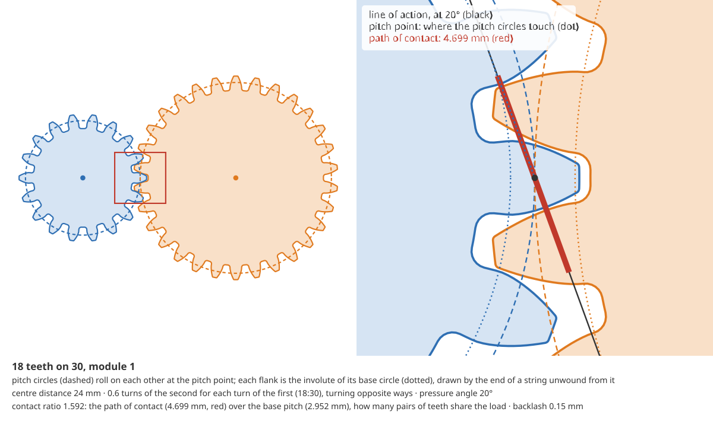

# @rulecad/gears

Gears for printed parts. An involute spur gear, a rack or a ring gear is drawn from three numbers (its module, its
teeth and its pressure angle) and the printer, with everything else following from them by rule. Each comes with its
numbers (pitch, base, tip and root diameters, tooth thickness), how a pair meshes (centre distance, ratio, contact
ratio, and the phase that puts a tooth in a gap) and how it prints. No dependencies but JSCAD. Part of
[rulecad](https://github.com/JoniBach/rulecad).

```js
import { gearModel, rackModel, spur, mesh, phase, printable } from '@rulecad/gears';

const pinion = gearModel({ module: 1, teeth: 18 });   // mm; 20° pressure angle unless you say
const wheel = gearModel({ module: 1, teeth: 42 });
const m = mesh(pinion, wheel, { centre: 30 });          // the axes you plan, checked
console.log(m.centre, m.ratio.toFixed(4), m.contact.toFixed(2), m.backlash);
console.log(m.findings.map((f) => `${f.level} ${f.code}`).join(', '));
console.log(phase(pinion, wheel, 0).toFixed(3));        // turn the wheel this far (degrees) to put a tooth in a gap
console.log(pinion.pitch, pinion.base.toFixed(3), pinion.tip, pinion.root);
console.log(printable(pinion, { line: 0.42, layer: 0.2, nozzle: 0.4 }, 6).map((f) => `${f.level}: ${f.text}`).join('\n'));
console.log(mesh(pinion, rackModel({ module: 1, teeth: 30 })).text);

const solid = spur({ module: 1, teeth: 18, width: 6, bore: 5 }); // a JSCAD solid, its face on the bed
```

```text
30 -0.4286 1.63 0.15
pass mesh.contact, pass mesh.centre
4.286
18 16.914 20 15.5
pass: module 1: 3.6 lines across a tooth at its pitch circle
pass: a tooth is 1.66 mm across at its root, 3.9 lines
56.55 mm of rack a turn (0.1571 mm a degree)
```

So the wheel turns 0.4286 times for each turn of the pinion, the other way; 1.63 pairs of teeth share the load on
average; the axes 30 mm apart leave the 0.15 mm of play the teeth were drawn with.



The picture is `diagram()` from `@rulecad/gears/diagram`: the pair in phase, and the mesh close up with the geometry
its numbers come from.

## The gears

| | What it is | Call |
|---|---|---|
| Spur gear | Teeth on the outside, straight across. Prints flat on the bed with no supports, its teeth in the layers. | `spur({ module, teeth, width, bore?, flat? })` |
| Rack | A gear of infinite radius: straight teeth on a bar, for a slide driven by a pinion. | `rack({ module, teeth, width, height? })` |
| Ring gear | Teeth on the inside of a ring, for a pinion turning within it (planetary gearboxes). Turns the same way as its pinion. | `internal({ module, teeth, width, rim? })` |
| Helical gear | A spur gear's teeth turned along the width by the helix angle: smoother and quieter, more teeth in mesh, but it pushes along its axis. | `helical({ module, teeth, width, helix, hand? })` |
| Herringbone | Helical one way to the middle and back: no push along the axis, it stays on its shaft and centres itself. Prints with no supports. | `herringbone({ module, teeth, width, helix? })` (30° by default) |

Each has a model with its numbers (`gearModel`, `rackModel`, `internalModel`) and an outline in 2D (`spurProfile`,
`rackProfile`, `internalProfile`: loops of `[x, y]` points). A spur gear's first tooth is on +x, its axis along z. A
rack lies along x, its pitch line on y = 0, its teeth up +y, its first space centred at x = 0.

What every gear takes:

| Parameter | Default | What it does |
|---|---|---|
| `module` | (required) | The size of a tooth, in mm: the pitch diameter over the number of teeth. Gears that mesh share it. |
| `teeth` | (required) | A whole number: 6 or more for a spur gear (17 or more at 20° without a shift), 12 or more for a ring. |
| `pressureAngle` | 20° | The angle the flanks push at. Gears that mesh share it. |
| `shift` | 0 | Profile shift, times the module: moves the teeth outwards, so a pinion of few teeth isn't undercut. |
| `backlash` | 0.15 mm | Play between mating teeth; each gear is drawn with half of it off its teeth. |
| `width` | (required for a solid) | Up z. A whole number of layers prints as drawn. |
| `chamfer` | 0.3 mm, at most a quarter module | Round the bed face, so the first layer's squish doesn't widen the teeth there. `[bed, top]` for both faces. |
| `bore`, `flat` | none | A hole for a shaft, and the depth of a flat across it (a D shaft). |
| `helix`, `hand`, `herringbone` | 0°, right, no | Helical teeth: the angle (up to 45°), which way they turn (`"right"` turns anticlockwise up z), and whether they turn back at the middle. Racks and rings take them too. `module` and `pressureAngle` stay the transverse ones, so the centre distance is a spur gear's. |

## How a pair meshes

`mesh(a, b, { centre })` takes two models: two outer gears, a pinion and a ring, or a pinion and a rack. It gives:

- **`centre`**: how far apart the axes must be (for a rack, the pinion's axis above the rack's pitch line). Shifted
  gears move apart by their working pressure angle.
- **`ratio`**: turns of b for each turn of a, negative when they turn opposite ways. For a rack, mm of travel a turn.
- **`contact`**: the contact ratio, how many pairs of teeth share the load on average. Under 1 the drive jumps; under
  1.2 it is rough.
- **`backlash`**: the play, with the centre you gave.
- **`overlap`** and **`thrust`**: for helical gears, with `width` given, how much the twist adds to the contact ratio, and the push along the axis for each newton driven (none for a herringbone).
- **`findings`**: `mesh.contact`, `mesh.centre` (axes closer than the gears need eat their backlash, 2 Δa tan α of it, and past
  it jam the teeth; too far apart, they knock), `mesh.module` and
  `mesh.pressure` (gears that can't mesh), `mesh.interference` (a ring too near its pinion's size), `mesh.helix` (helical
  gears that cross: outer gears that mesh are of opposite hands; a pinion and its ring or rack, of the same hand).

`phase(a, b, angle)` is the turn that puts a tooth of a in a space of b: b's angle is `ratio × a's angle + phase`,
with `angle` the direction from a's centre to b's. `rackPhase(pinion, at)` does the same for a rack.

## Planetary gearboxes

A sun in the middle, planets round it on a carrier, and a ring round them all. Hold one of the three and the other two
turn at a ratio set by the teeth alone. `planetary({ module, ratio, planets, held, input, output, size })` finds the
teeth for a ratio that also put together, nearest the ratio first and then the smallest:

- the ring is the sun and two planets across: R = S + 2P;
- the planets go in evenly spaced: S + R a whole number of times the number of planets;
- the planets' tips clear each other by a module, and the ring has at least 12 teeth more than a planet;
- the sun and planets have 17 teeth or more (`least`), so none is undercut; the rim fits `size` if given.

`best` holds the teeth (ring held, sun in, carrier out, 5:1: a sun of 18, three planets of 27, a ring of 72), each
planet's place round the carrier and the turn that puts it in phase with the sun, and the ring's turn. When no set
gives the ratio exactly, the nearest is returned and `planetary.ratio` says how far off it is (a fail past 5%).
`planetaryRatio({ sun, ring }, { held, input, output })` is the ratio of any teeth, any way round.

## The mesh, measured

`mesh()` reckons a pair from the formulas. `contact(a, b, { centre, steps })` measures it from the teeth as drawn,
with their fillets, rounds and backlash and the centre distance given. It turns the driver through one tooth in steps,
and at each step turns the driven gear each way until its outline meets the driver's:

- **backlash**: the turn between the two meetings, as play at the pitch circle (`mesh.backlash`, a warn when it falls
  under 0.02 mm);
- **transmission error**: how far the driven gear's forward meeting wanders across a tooth (`mesh.error`);
- **interference**: steps where the outlines already cross where the ratio puts them (`mesh.interference`).

`a` and `b` are the parameters the models take; `b.kind` is `'internal'` for a ring or `'rack'` for a rack. For 18
teeth on 30 at module 1 it measures 0.150 to 0.152 mm of play against the 0.15 mm drawn, and 1 µm of transmission
error; with the axes 0.2 mm apart, 0.30 mm (2 Δa tan α more). `cad check` measures every mesh in an assembly this way.

## How it prints

`printable(model, printer, width)` reads the gear against the printer (`{ line, layer, nozzle, wall_min }`, as in
`@rulecad/rules`) and returns findings, each `{ level, text, code, at }` with `at` on the first tooth:

- `gear.module`: a module under twice the nozzle prints a tooth as a blob (module 0.8 at a 0.4 mm nozzle).
- `gear.root`: a tooth narrower at its root than the thinnest wall.
- `gear.tip`: tips narrower than a line print as one bead.
- `gear.layers`: a width that isn't a whole number of layers.
- `gear.helix`: helical teeth lean most at their tips; past 45° the flanks sag. `gear.thrust` says the push along the axis.

Spur gears, racks and rings all print flat, with no supports: the teeth are in the layers, where the filament is
strongest. Every tooth has a round at its root (the commonest place a tooth cracks) and at its tip.

The defaults, each with its rule, are in `DEFAULTS`. The backlash, the chamfer, the tip round and the smallest module
are estimates until a printed sampler measures them.

## How strong it is

`strength(model, { width, material, torque?, safety?, speed? })` reads the teeth by the Lewis equation: the bending
stress at a tooth's root with the whole load at its tip, σ = F_t / (b m Y), Y the Lewis form factor for its teeth
(`lewisFactor(z)`). Given a torque (N·mm), it says the stress and how far under the material's strength
(`gear.strength`: a warn under the safety factor, 2 by default; a fail past the strength). Without one, it says the
torque the gear carries at the safety factor. Helical teeth are read in their normal section; a speed (rpm) adds
Barth's velocity factor.

```js
strength(gearModel({ module: 1, teeth: 18 }), { width: 6, material: { strength: 39, name: 'PLA' }, torque: 500 });
// at 0.5 N·m the teeth see 30 MPa at their roots (Lewis, Y 0.309): 1.3× under PLA's 39 MPa, under the 2× asked
```

It is a first number. A printed tooth is weaker than a moulded one where its layers and voids are, and stronger than
Lewis says where the root fillet and its neighbours share the load. Where it matters, print one and load it.

## What isn't refused, and what is

A model or a solid refuses what isn't a gear, by name, before any maths: `gearModel: teeth is a whole number of 6 or
more (got 4.5)`. It refuses a gear whose teeth would be undercut, naming the shift that fixes it, and teeth that come to
a point.

## The formulas

| Quantity | Formula | Source |
|---|---|---|
| Pitch diameter | d = m z | ISO 21771 |
| Base circle | d_b = d cos α | ISO 21771 |
| Tip and root | d_a = d + 2m (h_a + x), d_f = d − 2m (h_f − x); h_a = 1, h_f = 1.25 | ISO 53 basic rack |
| Tooth thickness on the pitch circle | s = m (π/2 + 2x tan α), less half the backlash | ISO 21771 |
| Tooth half-angle at radius ρ | s / d + inv α − inv α_ρ, with cos α_ρ = d_b / 2ρ, inv φ = tan φ − φ | Dudley (1984), ch. 2 |
| Undercut | none when z sin²α / 2 ≥ h_a − x (17 teeth at 20°) | ISO 21771; KHK |
| Working pressure angle | inv α_w = inv α + 2 tan α (x₁ + x₂) / (z₁ + z₂) | ISO 21771 |
| Centre distance | a = m (z₁ + z₂) cos α / 2 cos α_w; a ring: z₂ − z₁ | ISO 21771 |
| Contact ratio | (√(r_a1² − r_b1²) + √(r_a2² − r_b2²) − a sin α_w) / (π m cos α) | Dudley (1984); KHK |
| Rack contact | (√(r_a² − r_b²) − r sin α + m (h_a − x) / sin α) / (π m cos α) | KHK |
| Root fillet | 0.38 m | ISO 53 profile A |
| Helical twist | the profile turns z tan β / r up the width | ISO 21771 (transverse module) |
| Overlap ratio | ε_β = b tan β / π m (each half of a herringbone on its own) | ISO 21771 |
| Thrust | F_a = F_t tan β | Dudley (1984) |
| Flank lean at the tip | tan β_a = tan β · r_a / r | ISO 21771 |
| Ring and pinion | at least 10 teeth apart (12 to be safe) at 20° | KHK, internal gears |
| Planetary ratio | (ω_s − ω_c) / (ω_r − ω_c) = −R / S; ring held, sun in: 1 + R / S | Willis; Dudley (1984), ch. 3 |
| Planetary assembly | R = S + 2P; (S + R) / n whole; 2a sin(π / n) > d_a,planet | KHK, planetary gears |
| Tooth bending (Lewis) | σ = K_v F_t / (b m Y); helical: m cos β, z / cos³β teeth | Budynas and Nisbett, Shigley's Mechanical Engineering Design, 10th ed., §14-1 and Table 14-2 |
| Velocity factor (Barth, cut profile) | K_v = (3.05 + V) / 3.05, V in m/s | Shigley, eq. 14-4b |

## Words used

| Word | Meaning |
|---|---|
| Module | Tooth size: pitch diameter over teeth, in mm. Module 1 is about a 3 mm tooth pitch. |
| Pitch circle | The circle that rolls without slipping on its mate's. |
| Base circle | The circle the involute flank unwinds from, smaller than the pitch circle by cos α. |
| Involute | The curve the end of a taut string traces as it unwinds from a circle. Two involute gears turn at a steady ratio even when their centres are a little off. |
| Pressure angle | The angle the teeth push along, from the tangent to the pitch circles. |
| Line of action | The line the teeth touch along: tangent to both base circles, through the pitch point. |
| Contact ratio | The path of contact over the base pitch: how many pairs of teeth share the load on average. |
| Profile shift | Moving the teeth outwards (or in) by a fraction of the module, without changing the module or the teeth. |
| Backlash | Play between mating teeth, so they don't bind as printed parts vary. |
| Helix angle | How far helical teeth lean from straight across, at the pitch circle. |
| Hand | Which way helical teeth turn. Two outer gears that mesh are of opposite hands. |
| Undercut | A pinion of few teeth having its flank cut away under the base circle, or its mate's tip fouling there. |
| Sun, planets, carrier, ring | A planetary gearbox's parts: the middle gear, the gears round it, what holds the planets' axles, and the ring gear round them all. |

## Sources

- ISO 53:1998, *Cylindrical gears for general and heavy engineering: standard basic rack tooth profile*.
- ISO 21771:2007, *Gears: cylindrical involute gears and gear pairs, concepts and geometry*.
- D. W. Dudley, *Handbook of Practical Gear Design*, McGraw-Hill, 1984.
- KHK, *Gear Technical Reference* (khkgears.net): undercut, profile shift, internal gears.
- R. G. Budynas and J. K. Nisbett, *Shigley's Mechanical Engineering Design*, 10th ed., McGraw-Hill, 2015: the Lewis equation and form factors.
