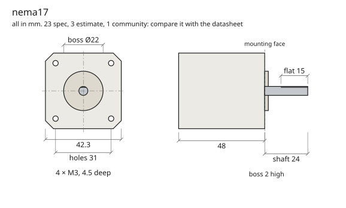
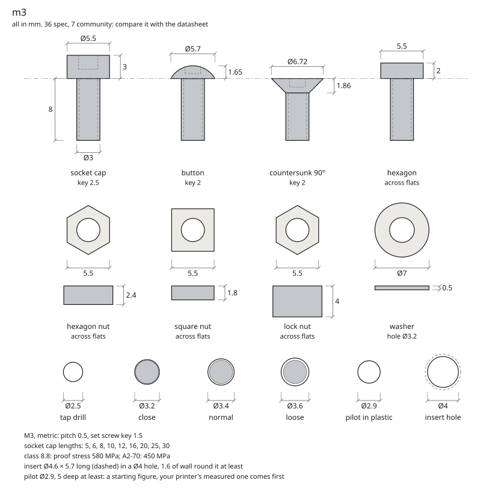
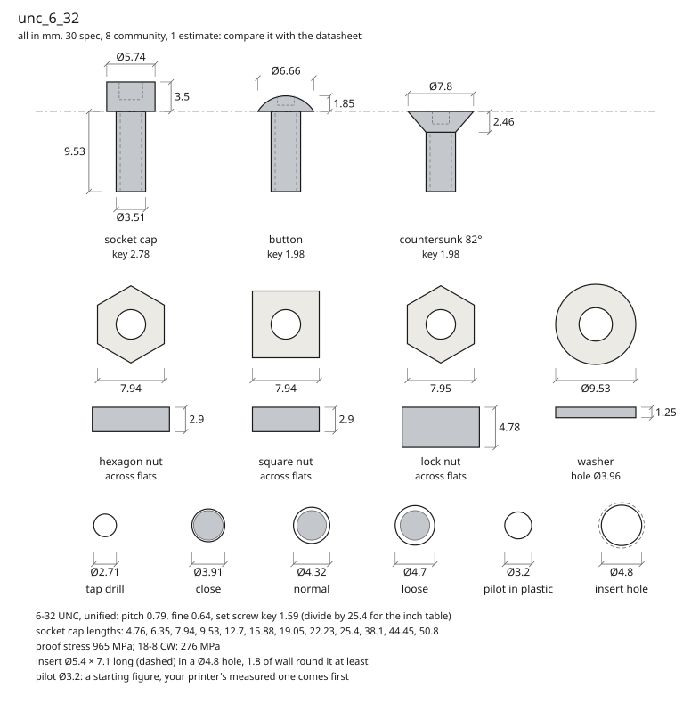
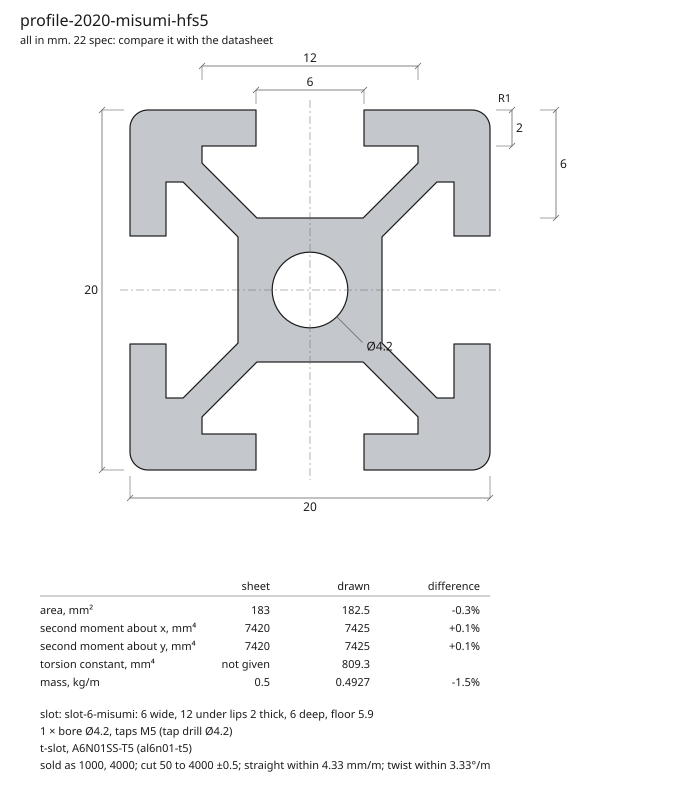

# @rulecad/rules

Researched facts for designing printed parts, as open data (CC0, public domain). Every value says what it is, where
it comes from and when it was checked, so a design built on it can be traced and corrected.

```json
"bed": { "value": 256, "unit": "mm", "rule": "Build volume is 256 × 256 × 256 mm", "kind": "spec",
         "source": "https://…", "checked": "2026-10-11" }
```

| Set | What | Values |
|---|---|---|
| `wire` | Hook-up wire by gauge: current density, service loop | 4 |
| `x1c` | Bambu Lab X1 Carbon: bed, line width, layer, overhang, bridges, fits, the gap parts printed in place need (and how far the first layer spreads), hole compensation, the gap a printed screw thread leaves its mate (`thread_gap`, an estimate), the fits of pins (`snap_clearance` round a snap pin's peg, `pin_press` and `pin_slip` for a plain pin, estimates until the fixings coupon measures them), and the measured pilot for an M3 screw in PLA (`pilot_m3`) | 21 |
| `mx` | Cherry MX switches: plate cut-out, stem, housing, travel, key pitch | 29 |
| `oem` | OEM keycap profile: heights and top tilt per row (from KeyV2) | 12 |
| `pico` | Raspberry Pi Pico: outline, headers, the GPIO on each pin | 18 |
| `promicro` | Pro Micro controller | 9 |
| `sod123` | SOD-123 diode footprint | 3 |
| `xiao` | Seeed Studio XIAO modules: outline, headers, the pin on each pad | 8 |
| `qwiic` | Qwiic / STEMMA QT sockets (JST SH, 4 pins): land pattern and pinout | 10 |
| `jstph` | JST PH (2.0 mm) battery connector | 3 |
| `jlcpcb` | JLCPCB's limits for two-layer boards | 14 |
| `wiring` | Room for hand wiring | 1 |
| `nema17`, `nema14` | NEMA 17 (48 mm body, StepperOnline's drawing) and NEMA 14 steppers: frame, boss, D shaft, holes, torque, current, inductance. For a 40 mm NEMA 17 give its length and torque | 23, 23 |
| `28byj48` | The 28BYJ-48 5 V geared stepper: can, ears, the offset double-flat shaft, ratio, torque at the output | 28 |
| `n20` | An N20 gear motor (Pololu's 100:1 HP 6 V drawing and figures): section, D shaft, M1.6 holes, stall and free-running output | 23 |
| `sg90`, `mg90s` | 9 g and 13 g servos: case, tabs, holes, output, stall torque, speed and range | 24, 24 |
| `bldc2204` | A 2204 brushless gimbal motor, 260 KV: bell, hub, KV, current (its bolt pattern changes from maker to maker: measure yours) | 16 |
| `m1_6`, `m2`, `m2_5`, `m3`, `m4`, `m5`, `m6`, `m8`, `m10`, `m12` | ISO metric threads M1.6 to M12, one set each, with everything that hangs off the thread: pitch, tap drill, the three ISO 273 clearance holes, socket cap, button, countersunk and hexagon heads, hexagon, square and lock nuts, washer, set screw, the lengths sold, strength, a heat-set insert (M2 to M5) and a starting pilot in plastic | 30 to 46 each |
| `unc_4_40`, `unc_6_32`, `unc_8_32`, `unc_10_24`, `unf_10_32`, `unc_1_4_20`, `unc_5_16_18`, `unc_3_8_16` | Unified inch threads 4-40 to 3/8-16 to the same names, in millimetres, each rule's text giving its inch figure: ASME B1.1 threads, ASME B18.3 socket screws, with holes, nuts, washers and lengths | 39 to 49 each |
| `pt_k22`, `pt_k25`, `pt_k30`, `pt_k35`, `pt_k40`, `pt_k50` | Thread-forming screws for plastic (the PT type, WN 1412), 2.2 to 5 mm: thread, pan head with a Torx variant, and the maker's pilot, depth and boss for ABS. Community until measured in printed plastic | 11 each |
| `engagement` | How much thread a screw needs in what it screws into, in screw diameters: steel, aluminium, plastic | 3 |
| `pins` | Plain pins for joining printed parts: the diameters and lengths an ISO 8734 steel dowel is sold in, its m6 tolerance, the shear strength a steel pin is taken to have (an estimate), and 1.75 mm filament as a pin with its tolerance | 6 |
| `hexkey` | Hex keys (ISO 2936): sizes, width across corners, long and short arms, how far a ball end tilts, and a socket's wall: what a key needs to reach a screw's head | 6 |
| `packs` | How small fixings are bought: the pack a shopping list rounds a count up to (an estimate) | 1 |
| `rp2040` | The RP2040 microcontroller: which package pins carry which GPIO | 2 |
| `dial-indicator` | A dial indicator with a plunger, for measuring small movements | 2 |
| `pla`, `petg` | Bambu Lab PLA Basic and PETG HF, printed, for analysis: stiffness and strength along the layers and across them, and what a kilogram costs (its EU store's price with VAT) | 7, 8 |
| `bearing-608`, `bearing-625`, `bearing-6800`, `bearing-f623`, `bearing-51104` | Ball bearings from NTN's figures: 608, 625, 6800, the flanged F623 and the 51104 thrust bearing: bore, outer diameter, width, chamfer, ratings, radial play class | 9, 9, 9, 10, 10 |
| `bearing-mr105` | MR105 miniature bearing, 5 x 10 mm (4 wide shielded, 3 open), distributor figures: community until measured | 8 |
| `endstop-10t85` | The lever microswitch endstop marked 10T85: body, holes, force. Community until measured, and its lever travel is not published anywhere found | 12 |
| `as5600` | AS5600 magnetic encoder board and its 6 mm diametric magnet: resolution, air gap, field, board size | 15 |
| `a4988`, `drv8825`, `tmc2209` | Stepper driver modules on the StepStick footprint: voltages, current with and without cooling, sense resistor, Vref formula and gain, microsteps, header spacing, pinout. The TMC2209's module figures are community until measured | 18, 18, 19 |
| `cnc-shield-v3` | Arduino CNC shield V3: step, direction, enable and limit pins on the Uno, the Z limit quirk between revisions, A axis jumpers, microstep jumpers. Community until measured | 19 |
| `supply-12v`, `supply-24v` | Enclosed 12 V and 24 V switching supplies by current (Mean Well's LRS series as variants): current, power, case size. Community until measured | 7, 8 |
| `t8-screw` | T8 trapezoidal lead screw, 8 mm, 2 mm pitch: 8 mm lead (Tr8x8(P2)), with variants for 2 and 4 mm leads; helix, an efficiency note and an assumed friction. Community until measured | 10 |
| `t8-nut` | Flanged nut for a T8 screw: brass drawing (flange, body, hole circle), POM variant by material only. Community until measured | 12 |
| `rod-8` | 8 mm hardened ground linear shaft: diameter, tolerance, hardness. Community until measured | 5 |
| `lm8uu`, `lm8luu` | Linear ball bushings 8 x 15 x 24 and 8 x 15 x 45: bore, outer diameter, length, ratings (Samick's figures from distributors). Community until measured | 6, 6 |
| `coupler-5-8` | 5 mm to 8 mm flexible coupler: bores, length, outer diameter. Community until measured | 5 |
| `gt2-belt-6` | GT2 (2MGT) belt, 6 mm wide: pitch, pitch line offset, width, stiffness per unit strain and per width, rated tension, smallest idlers (Gates's figures; unbranded belt community until measured) | 11 |
| `pulley-gt2-16`, `pulley-gt2-20` | GT2 16 and 20 tooth pulleys for 6 mm belt with a 5 mm bore: teeth, pitch and tooth diameters (Gates's), bore, rim, width. Community until measured, Gates's own sprockets as variants | 8, 8 |
| `idler-gt2-toothed-20`, `idler-gt2-smooth-20` | GT2 idlers with bearings for 6 mm belt, 5 mm bore, toothed and smooth. Community until measured | 6, 5 |
| `al6061`, `al7075`, `s275`, `ss304`, `ti64` | Aluminium 6061-T6 and 7075-T6, structural steel S275, stainless 304, titanium Ti-6Al-4V, for analysis | 4 or 5 each |
| `al6063-t5`, `al6063-t6`, `al6063-t66`, `al6060-t66`, `al6005a-t6` | The extrusion alloys framing profiles are made of, each in its temper: modulus, shear modulus, the least proof stress and tensile strength EN 755-2 allows, density (Hydro's alloy data sheets) | 6 each |
| `al6n01-t5`, `al6060-rexroth` | The same for two makers' own material figures: MISUMI's JIS A6N01SS-T5 and Bosch Rexroth's EN AW-6060 | 5 each |
| `slot-6-misumi`, `slot-8-misumi`, `slot-10-misumi`, `slot-10-misumi-45` | The T-slots of MISUMI's 5, 6, 8 and 8-45 series extrusions (20, 30, 40 and 45 mm): opening, lip, cavity width and depth from the catalogue, the floor and flanks scaled off its drawing | 7 each |
| `slot-6-bosch`, `slot-8-bosch`, `slot-10-bosch` | Bosch Rexroth's 6, 8 and 10 mm slots (20, 30 and 40 mm strut profiles), from the MGE 14.0 catalogue | 7 each |
| `slot-6-motedis`, `slot-10-motedis` | The slots of Motedis' B-type profiles: opening and depth from Motedis, the rest Rexroth's figures and marked community | 7 each |
| `slot-6`, `slot-8`, `slot-8-i` | Generic slots for unbranded stock: the 20 and 30 mm series' B-type slots and the 40 mm series' I-type slot 8, from named sellers' outlines. Community until measured | 7 each |
| `profile-2020-misumi-hfs5`, `profile-2040-misumi-hfs5`, `profile-3030-misumi-hfs6`, `profile-3060-misumi-hfs6`, `profile-4040-misumi-hfs8`, `profile-4080-misumi-hfs8`, `profile-4545-misumi-hfs8`, `profile-4590-misumi-hfs8` | MISUMI HFS aluminium extrusions, 20 to 45 mm, one and two cells: section dimensions, bores and the thread each taps to, area, second moments, mass, alloy, lengths and tolerances, from the catalogue's pages | 22 to 27 |
| `profile-2020-bosch`, `profile-2040-bosch`, `profile-3030-bosch`, `profile-4040-bosch-l` | Bosch Rexroth strut profiles 20x20, 20x40, 30x30 and 40x40L, with the catalogue's torsion constants | 26 to 30 |
| `profile-2020-motedis-b6`, `profile-4040-motedis-b10` | Motedis B-type profiles 20x20 (slot 6) and 40x40 (slot 10): Motedis' own section figures, with what it does not print taken from Rexroth's and marked community | 20 to 23 |
| `profile-2020-generic`, `profile-2040-generic`, `profile-3030-generic`, `profile-4040-generic` | Stand-ins for unbranded 2020, 2040, 3030 and 4040 stock, from two named sellers. Community until measured: unbranded stock is sold in more than one section under each name | 22 to 25 |
| `al6000-item` | The aluminium of item's profiles (an EN AW-6000 series AlMgSi alloy): item's own modulus, shear modulus, least proof stress and tensile strength, density | 6 |
| `slot-5-item`, `slot-6-item`, `slot-6-item-light`, `slot-8-item`, `slot-8-item-light` | The grooves of item's Lines 5, 6 and 8 (20, 30 and 40 mm), standard and light: opening, lip, width and depth from item's table of groove dimensions, the floor and flanks scaled off its drawings. A light groove takes the standard groove's nuts | 7 each |
| `profile-2020-item-5`, `profile-2040-item-5`, `profile-3030-item-6`, `profile-3060-item-6`, `profile-3030-item-6l`, `profile-3060-item-6l`, `profile-4040-item-8`, `profile-4080-item-8`, `profile-4040-item-8l`, `profile-4080-item-8l` | item profiles of Lines 5, 6 and 8, one and two cells, standard and light (`l`): dimensions and every section figure (torsion included) from item's product data sheets, tolerances from its technical data | 26 to 30 |
| `slot-10-bosch-45l` | Bosch Rexroth's 10 mm slot as its 45 mm light sections have it: 14.5 deep where the 40 mm series is 12.5. It takes the same nuts | 7 |
| `profile-3060-bosch`, `profile-4080-bosch-l`, `profile-4545-bosch-l` | Bosch Rexroth strut profiles 30x60, 40x80L and 45x45L, with the catalogue's torsion constants | 28 to 30 |
| `profile-2060-misumi-hfs5`, `profile-2080-misumi-hfs5` | MISUMI HFS5-2060 and HFS5-2080: three and four cells of the 5 series in a row | 23 each |
| `slot-5-motedis`, `slot-6-motedis-i`, `slot-8-motedis-i` | The slots of Motedis' I-type profiles (made to match item's Lines 5, 6 and 8): what Motedis prints, the rest item's figures and marked community | 7 each |
| `profile-2020-motedis-i5`, `profile-2040-motedis-i5`, `profile-3030-motedis-i6`, `profile-4040-motedis-i8`, `profile-4080-motedis-i8` | Motedis I-type profiles 20x20 and 20x40 (slot 5), 30x30L (slot 6), 40x40L and 40x80L (slot 8): Motedis' own section figures, with what it does not print taken from item's and marked community | 21 to 25 |
| `slot-10` | A generic 10 mm slot for unbranded B-type stock of the 40 and 45 mm series: the opening from a named seller, the rest Rexroth's figures. Community until measured | 7 |
| `profile-tube`, `profile-round-tube`, `profile-angle`, `profile-channel`, `profile-bar`, `profile-round-bar` | Plain sections as families: square and rectangular tube, round tube, angle, channel, flat and round bar. Each holds a starting size and material; any other is given by size, wall and material, and its section figures are worked out from its outline | 4 to 6 |
| `profile-tube-al-20x20x2`, `profile-tube-al-25x25x2`, `profile-tube-al-40x20x2`, `profile-tube-steel-25x25x2`, `profile-tube-steel-40x40x2`, `profile-round-tube-al-25x2`, `profile-round-tube-steel-25x2`, `profile-angle-al-25x25x3`, `profile-angle-steel-30x30x3`, `profile-channel-al-30x20x2`, `profile-bar-al-25x5`, `profile-bar-steel-30x5`, `profile-round-bar-al-10`, `profile-round-bar-steel-10` | Ready sizes of the plain families in aluminium (6063-T5) and steel (S275), named `profile-<family>-<al or steel>-<size>`: nominal sizes, to measure against the bar in hand | 4 to 6 |
| `profile-custom` | The custom family: any closed outline, with its section figures worked out from it. The kit's own example is a T section, its outline in `outlines/profile-custom.json` | 4 |
| `slot-6-openbuilds` | The slot of OpenBuilds V-Slot rail: a T-slot with a V mouth for wheels. Opening, lip, width and height under the lips and the V track (`track_width`, `track_angle`) from OpenBuilds' drawing; the floor and flanks scaled off it | 9 |
| `profile-2020-openbuilds`, `profile-2040-openbuilds`, `profile-2060-openbuilds`, `profile-2080-openbuilds`, `profile-4080-openbuilds-cbeam` | OpenBuilds V-Slot 20x20, 20x40, 20x60, 20x80 and C-Beam (six cells in a C, with slots inside it): sizes, bores and lengths from OpenBuilds' pages. It publishes no section figures, so they are worked out from the outline | 13 to 16 |
| `al6005a-8020` | The aluminium of 80/20's profiles ("6005A-T61 or comparable"): 80/20's own modulus, yield and tensile strength, the density worked out from its weight and area | 5 |
| `slot-6-8020`, `slot-8-8020` | The T-slots of 80/20's 10 series (1 in) and 15 series (1.5 in), in mm with the inch figure in each rule: opening, lip, width, depth and the 2 degree drop lock from the catalogue's drawings | 8 each |
| `profile-1010-8020`, `profile-1020-8020`, `profile-1515-8020`, `profile-1530-8020` | 80/20 inch T-slot profiles 1010, 1020, 1515 and 1530: dimensions and section figures from its Product Catalog 24 in mm, each rule giving the inch figure; bores tapped 1/4-20 (`unc_1_4_20`) and 5/16-18 (`unc_5_16_18`) | 20 or 21 |
| `slot-3-makerbeam`, `slot-3-makerbeam-xl`, `slot-3-openbeam` | The slots of the small beams, and what each takes: MakerBeam's a square headed M3 bolt, MakerBeamXL's and OpenBeam's a plain M3 nut (DIN 934). From MakerBeam B.V.'s drawings and OpenBeam's dimensioned section | 7 to 9 |
| `profile-1010-makerbeam`, `profile-1515-makerbeam-xl`, `profile-1515-openbeam` | MakerBeam (10 mm), MakerBeamXL and OpenBeam (15 mm): dimensions, the M3 core hole, area, second moments and weight from MakerBeam B.V.'s drawings and overview of specifications | 16 to 21 |
| `profile-1515-printed`, `profile-2020-printed`, `profile-3030-printed`, `profile-4040-printed`, `slot-3-printed-1515`, `slot-6-printed-2020`, `slot-8-printed-3030`, `slot-8-printed-4040` | Beams to print lying down with no support: one slot on top, its lips sloped underneath at the printer's overhang angle, taking OpenBeam's M3 nut (15) or MISUMI's 6 mm (20) and 8 mm (30, 40) slot nuts; solid below, with a heat-set insert or a captive nut in each end. Worked out by `@rulecad/frames` `printedProfile` from the nuts' sizes and the X1C's rules, so every figure is derived | 8 or 12 |
| `slot-nut-3-openbeam-m3-hex` | A plain M3 hex nut (ISO 4032) in OpenBeam's slot, which is made to capture one | 9 |
| `slot-nut-6-misumi-m3-drop-in`, `slot-nut-6-misumi-m3-roll-in`, `slot-nut-6-misumi-m3-slide-in`, `slot-nut-6-misumi-m3-square`, `slot-nut-6-misumi-m4-drop-in`, `slot-nut-6-misumi-m4-roll-in`, `slot-nut-6-misumi-m4-slide-in`, `slot-nut-6-misumi-m4-square`, `slot-nut-6-misumi-m5-roll-in`, `slot-nut-6-misumi-m5-slide-in`, `slot-nut-6-misumi-m5-square`, `slot-nut-8-misumi-m3-drop-in`, `slot-nut-8-misumi-m3-roll-in`, `slot-nut-8-misumi-m3-slide-in`, `slot-nut-8-misumi-m4-drop-in`, `slot-nut-8-misumi-m4-roll-in`, `slot-nut-8-misumi-m4-slide-in`, `slot-nut-8-misumi-m4-square`, `slot-nut-8-misumi-m5-drop-in`, `slot-nut-8-misumi-m5-roll-in`, `slot-nut-8-misumi-m5-slide-in`, `slot-nut-8-misumi-m5-square`, `slot-nut-8-misumi-m6-drop-in`, `slot-nut-8-misumi-m6-roll-in`, `slot-nut-8-misumi-m6-slide-in`, `slot-nut-8-misumi-m6-square` | MISUMI's nuts for its 5 series (6 mm slot) and 6 series (8 mm slot): HNTT slide-in, HNTF drop-in (M3 and M4 only in the 6 mm slot), HNTP roll-in with a sprung ball, HNKK square plate. Sizes, heights and tongues from the 2014 catalogue's drawings; MISUMI gives a tightening torque, so each hold is an estimate | 10 to 11 each |
| `slot-nut-6-bosch-m3-roll-in`, `slot-nut-6-bosch-m4-drop-in`, `slot-nut-6-bosch-m4-roll-in`, `slot-nut-6-bosch-m4-slide-in`, `slot-nut-6-bosch-m5-roll-in`, `slot-nut-6-bosch-m5-slide-in`, `slot-nut-8-bosch-m4-drop-in`, `slot-nut-8-bosch-m4-roll-in`, `slot-nut-8-bosch-m4-slide-in`, `slot-nut-8-bosch-m5-drop-in`, `slot-nut-8-bosch-m5-roll-in`, `slot-nut-8-bosch-m5-slide-in`, `slot-nut-8-bosch-m6-drop-in`, `slot-nut-8-bosch-m6-roll-in`, `slot-nut-8-bosch-m6-slide-in`, `slot-nut-8-bosch-m6-t-bolt`, `slot-nut-8-bosch-m8-roll-in`, `slot-nut-8-bosch-m8-slide-in` | Bosch Rexroth's nuts for its 6 and 8 mm slots: the T-nut (drop-in), sliding block (slide-in), swivel-in block (roll-in) and the M6x20 T-bolt, from MGE 14.0, with Rexroth's Fmax where it gives one; a width it does not dimension is an estimate | 10 to 11 each |
| `slot-nut-6-motedis-m4-hammer`, `slot-nut-6-motedis-m5-hammer`, `slot-nut-6-motedis-m5-slide-in`, `slot-nut-6-motedis-m5-square`, `slot-nut-8-i-motedis-m4-hammer`, `slot-nut-8-i-motedis-m4-roll-in`, `slot-nut-8-i-motedis-m5-hammer`, `slot-nut-8-i-motedis-m5-roll-in`, `slot-nut-8-i-motedis-m6-hammer`, `slot-nut-8-i-motedis-m6-roll-in`, `slot-nut-8-i-motedis-m8-roll-in`, `slot-nut-8-motedis-m4-hammer`, `slot-nut-8-motedis-m4-roll-in`, `slot-nut-8-motedis-m5-hammer`, `slot-nut-8-motedis-m5-roll-in`, `slot-nut-8-motedis-m6-hammer`, `slot-nut-8-motedis-m6-roll-in`, `slot-nut-8-motedis-m8-roll-in` | Motedis' hammer nuts, heavy slide-in nut, threaded plate and sprung roll-in nuts for its B-type 6 and 8 mm and I-type 8 mm slots, from Motedis' drawings (one size drawn: the other threads take its body, and say so) | 10 to 11 each |
| `slot-nut-6-openbuilds-m5-drop-in` | OpenBuilds' drop-in tee nut for V-Slot, M5: its overall "6 x 10.3 x 4.4mm", the step under it taken from the same nut drawn by Motedis | 11 |
| `fitting-motedis-bracket-20-b6`, `fitting-motedis-plate-t-20`, `fitting-motedis-inner-20-b6`, `fitting-misumi-hmj5`, `fitting-motedis-hinge-20`, `fitting-motedis-end-cap-20-b6`, `fitting-motedis-foot-m6-d19` | Bought fittings for 20 mm frames (part `fitting`), from the makers' drawings and shop pages: Motedis' cast corner bracket, T joining plate, inner connector, light hinge, end cap and levelling foot, and MISUMI's centre joint (an anchor connector in a hole drilled across the beam). Each says what it mounts by (its screws, nuts and holes on each beam), its price where the seller lists one, and its stiffness, an estimate until the joint rig measures it | 7 to 18 each |
| `rail-mgn7`, `rail-mgn9`, `rail-mgn12`, `rail-mgn15` | Miniature linear guides (part `rail`) from HIWIN's MG Series catalogue: the rail's size, hole pitch and end distance, its counterbored holes and screw, its mass per metre and its running parallelism; the standard carriage in the rules and the long one as a variant (`MGN12C`, `MGN12H`), each with its length, holes, mass, load ratings C and C0, moment ratings MR, MP and MY, play and stiffness | 30 each |
| `v-wheel-solid`, `v-wheel-mini` | OpenBuilds' Delrin V-wheels for V-Slot (part `wheel`), read off OpenBuilds' drawings: the rim's diameter, width and flat, its 90 degree V, its bearing seats and the bearings it runs on (`bearing-625`, `bearing-mr105`), the eccentric spacer made for it, the plain spacer under a fixed wheel, and where OpenBuilds' own plate puts the wheels across a 20 mm rail. The plastic's modulus and allowed contact pressure are Delrin 150's (`community`: the grade is not named), Poisson's ratio an `estimate` | 19 each |
| `eccentric-6-openbuilds`, `eccentric-mini-6-openbuilds` | OpenBuilds' eccentric spacers (part `eccentric`) that set a wheel's preload: the bore's 0.79 mm offset, the cam height, the rim that turns in the plate's 7.2 mm hole and the spanner across the hex | 8 each |

`kind` says how far to trust a value: **spec** (a datasheet or manufacturer), **community** (a widely used figure, such
as KiCad's library or KeyV2), **default** (a setting that works), **derived** (read off someone else's model with `cad measure`: check it
against the real thing, and see its `licence`), or **estimate** (nobody has published it: measure it and correct it). Use them with `@rulecad/variables` (`uses: ['x1c']`, then `x1c.line * 3` in any expression), or read
the JSON from anywhere.

**Shared names.** A set that describes a part (`"part": "motor"`, or bearing, switch, encoder, driver, board, supply, leadscrew, nut, rod, linear_bearing, coupler, belt, pulley, idler, thread, profile, slot, slot_nut) uses the names in [`vocabulary.json`](vocabulary.json):
`body_*`, `boss_*`, `shaft_*`, `mount_*`, `cable_*` and the rest, each in its unit, so one piece of code can read any of
them. An older set keeps its own names and says which is which (`"interface": { "body_length": "length" }`). `cad rules
check` holds every set to all this. `cad rules draw nema17` draws what a set says the part mounts by, for comparing with
its datasheet by eye:



Bearings, linear bearings, nuts, couplers, pulleys and idlers draw as an end view and a section (bore, outer diameter, width or length, any flange and hole circle), a lead screw from the side with pitch against lead, a belt as a short length with its pitch, and driver modules as the board with its two header rows at their spacing, so a bought part can be held against its datasheet the same way.

**Threads.** Each thread size is one set with `"part": "thread"`, holding everything that hangs off that thread under
the same names whatever the size, so `m3.clearance`, `m8.clearance` and `unc_1_4_20.clearance` mean the same thing.

| Names | What | From |
|---|---|---|
| `thread_form`, `thread`, `major_diameter`, `pitch`, `pitch_fine`, `tap_drill` | The thread: `metric`, `unified` or `plastic`, as it is written (`M3`, `6-32 UNC`), its diameter and pitch, and the drill for tapping it | ISO 261, ISO 262, ISO 2306; ASME B1.1 |
| `clearance_close`, `clearance`, `clearance_loose` | Clearance holes. `clearance` is the normal fit | ISO 273; ASME B18.2.8 |
| `head`, `head_height`, `head_key` | The socket head cap screw | ISO 4762; ASME B18.3 |
| `button_head`, `button_head_height`, `button_key` | The button head socket screw | ISO 7380-1; ASME B18.3 |
| `countersunk_head`, `countersunk_head_height`, `countersunk_angle`, `countersunk_key` | The countersunk socket screw: 90° metric, 82° inch | ISO 10642; ASME B18.3 |
| `hex_head_flats`, `hex_head_height` | The hexagon head screw | ISO 4017; ASME B18.2.1 |
| `nut_flats`, `nut_height`, `square_nut_flats`, `square_nut_height`, `lock_nut_flats`, `lock_nut_height` | Hexagon, thin square and nylon-insert lock nuts | ISO 4032, DIN 562, DIN 985; ASME B18.2.2, B18.6.3 |
| `washer_bore`, `washer_diameter`, `washer_thickness` | The plain washer | ISO 7089; ASME B18.21.1 |
| `set_screw_key`, `set_screw_point` | The socket set screw | ISO 4026; ASME B18.3 |
| `lengths` | The lengths a socket head cap screw is sold in: a list | ISO 4762; a named catalogue for inch |
| `property_class`, `proof_stress`, `stainless_class`, `stainless_proof_stress` | Strength: steel, then stainless as a second figure | ISO 898-1, ISO 3506-1; ASTM A574 |
| `insert_diameter`, `insert_length`, `insert_hole`, `insert_depth`, `insert_wall` (`insert_taper` where a maker asks for one) | A heat-set insert and the straight hole it melts into, `community`. Shorter inserts of the same thread are `variants` | CNC Kitchen's dimensions and design guidelines sheet |
| `pilot`, `pilot_depth`, `pilot_boss` | A starting hole, as drawn, for the screw to form its own thread in printed plastic: `community` for M2 to M4, and an `estimate` for the sizes with no published figure. A printer's measured figure comes first: `x1c.pilot_m3` | Bambu Lab's guide to screw holes; PSM's sheet for thread-forming screws |

A size carries only what its standard makes in that size: there is no M2 button head in ISO 7380-1, so `m2` has no
`button_head`. The names designs have read since the first release keep their values: `clearance` is the ISO 273
normal hole, `head` and `head_height` the ISO 4762 head, `nut_flats` and `nut_height` the ISO 4032 nut, `insert_hole`
and `insert_length` the insert. Each is the vocabulary's own name for its figure, so nothing is renamed. Three are also
read under the vocabulary's shared names for the screw a part mounts by, which a motor's mount reads: each thread set
lists them as aliases in `"interface"` (`screw_clearance` is `clearance`, `screw_head` is `head`, `screw_head_height`
is `head_height`), and `cad rules check` says so as a note, never a failure. A workspace keeps its own copy of a set
it has used (`rules/m3.json`), and the copy is read as it is after an upgrade: `cad rules check m3` lists what the
kit's set has that the copy lacks, to copy across, or the copy can be deleted to read the kit's. Where an older
DIN and the current ISO disagree (a 16 mm M10 nut where DIN 934 made it 17), the set holds the ISO figure and its rule
says so: measure the nuts you have before cutting a pocket for them.

`lengths` is a list: `"value": [5, 6, 8, 10, 12, 16, 20, 25, 30]`. A design reads it as an array (`v.m3.lengths`), and
an expression takes `min(m3.lengths)` or `max(m3.lengths)`.

`cad rules check` holds a thread to its vocabulary and to sense: a head wider than its loosest clearance hole, a tap
drill close to the major diameter less the pitch, holes in the order close, normal, loose, and lengths ascending.
`cad rules draw m3` draws the screw in each head form the size is made in, its nuts and washer, and its holes:



A screw made for plastic (`pt_k30`: the PT type, 3 mm) is a thread set too, with `"thread_form": "plastic"`, its pan
head (`pan_head`, `pan_head_height`, `pan_head_drive`, and a `torx` variant), its `root_diameter`, and its maker's
pilot, depth and boss for ABS. It has no tap drill and no nut. `engagement` holds how much thread a screw needs in
steel, aluminium and plastic, in screw diameters: `m3.major_diameter * engagement.plastic`.

An inch set holds millimetres like every other set, and each rule's text gives the inch figure it came from, so
`unc_6_32.head` is 5.74 and its rule reads "at most: 0.226 in". `cad rules draw unc_6_32` draws the screw a PC case
uses:



**Profiles, slots and slot nuts.** A beam's section is a set with `"part": "profile"`, whatever it is: slotted
extrusion, tube, angle, channel, bar, a section printed in plastic or an outline of your own. One maker's profile is
one set, because two makers' "2020" differ in their slots, and a file's name says which it is:

| File | What |
|---|---|
| `profile-<size>-<maker>[-<the maker's series or type>]` | A profile: `profile-2020-misumi-hfs5`, `profile-4040-bosch-l`, `profile-2020-generic`, `profile-1515-8020` (an inch size as its maker writes it, held in mm), `profile-4080-openbuilds-cbeam`. Makers so far: `misumi`, `bosch`, `item`, `motedis`, `openbuilds`, `makerbeam`, `openbeam`, `8020`, and `generic` for unbranded stock. The size is cells of the series, across then up, as it is sold (`2040`), so files sort by size and then by maker |
| `profile-<family>` and `profile-<family>-<al or steel>-<size>` | A plain section's family (`profile-tube`, `profile-angle`, `profile-round-bar`) and a ready size of it (`profile-tube-al-25x25x2`, `profile-round-bar-steel-10`): width, height and wall as the family has them. `profile-custom` is any closed outline, with its outline in `outlines/<the set's name>.json` |
| `slot-<opening>[-<maker>][-<variant>]` | A slot family: `slot-6-bosch`, `slot-10-misumi-45`. With no maker it is the generic one for unbranded stock (`slot-6`, `slot-8`, and `slot-8-i` for the 40 mm series' I-type slot) |
| | A slot's own names: `opening`, `lip_thickness`, `lip_angle`, `cavity_width`, `cavity_depth`, `floor_width` with `flank_angle` (both left out for straight walls), `track_width` with `track_angle` (a V-slot's mouth), `groove_width` with `groove_depth` (a groove down the floor), `nut_family` |
| `slot-nut-<opening>[-<maker>][-<variant>]-<thread>-<kind>` | A slot nut for that maker's slot: `slot-nut-6-misumi-m5-slide-in`, `slot-nut-8-i-motedis-m5-roll-in`, `slot-nut-6-openbuilds-m5-drop-in`. Its `slot` names the slot family it is made for |
| `al<alloy>-<temper>` | The material a profile names: `al6063-t5` |

A profile is read at three levels, and only the first is needed to draw it:

| Level | Names | What |
|---|---|---|
| Interface | `family`, `series`, `cells_across`, `cells_up`, `cells_absent`, `width`, `height`, `corner_radius`, `wall` | What sort of section (`t-slot`, `v-slot`, `tube`, `round-tube`, `angle`, `channel`, `bar`, `round-bar`, `custom`, `printed`), its base size, how many cells and any that are not there (a C-beam is 4 by 2 with `"2,2; 3,2"` absent), its envelope, a tube's wall |
| | `slot`, `slot_top`, `slot_bottom`, `slot_front`, `slot_back` | The slot family in every face by its set's name (or `closed`), then any face that differs: a family, `closed`, or one of either per slot (`slot-6-bosch, closed`) |
| | `bore_diameter`, `bore_thread`, `bore_at`, `corner_bore_diameter`, `corner_bore_thread`, `corner_bore_inset` | The bore in the middle of each cell and the thread it taps to (`M5`), holes in the corners, and bores anywhere else as `x,y; x,y` |
| | `chamber_width`, `chamber_length`, `chamber_depth`, `corner_hollow_width`, `corner_hollow_wall` | The closed hollow between two cells, and square hollows in the corners of a lighter section |
| Section | `area`, `inertia_x`, `inertia_y`, `section_modulus_x`, `section_modulus_y`, `torsion_constant`, `mass_per_metre`, `alloy`, `material` | What the sheet says the section is worth, in mm², mm⁴, mm³ and kg/m (a sheet's cm figures are converted, and the rule gives them as printed), its alloy as written and the material set to analyse it with |
| Supply | `lengths`, `cut_length_min`, `cut_length_max`, `cut_tolerance`, `straightness_per_metre`, `twist_per_metre` | The bars it is sold as, what a maker cuts it to, and how true it is |
| Outline | `rules/outlines/<set name>.json` | The measured section as closed loops, where the interface dimensions do not describe it |

A slot family (`"part": "slot"`) is described once and named by every profile that has it: `opening` between the lips,
`lip_thickness`, `cavity_width` under the lips, `cavity_depth` to the floor, then how it closes in (`floor_width`,
`flank_angle`, and `lip_angle` where the lip's underside slopes), a V-slot's mouth (`track_width`, `track_angle`) and
the `nut_family` whose nuts it takes. A slot nut (`"part": "slot_nut"`) names its `slot`, its `thread`, its
`nut_kind` (`slide-in`, `drop-in`, `roll-in`, `hammer`, `t-bolt`, `square`, `hex`), its `length`, `width` and `height`,
and its `nut_entry` (`anywhere`, or `end` for one that needs an open end). `height` is the body under the lips; the
step that stands up into the opening is `tongue_width` by `tongue_height`. `hold` is the pull straight out of the slot it
takes (newtons): the maker's figure where it gives one (Rexroth's Fmax), otherwise an estimate that says what it rests
on, until such nuts are tested. A maker's `tightening_torque` (N m), a T-bolt's `bolt_length` and the `material` complete
it. A nut is drawn and weighed by `@rulecad/frames` (`slotNutModel`, `nutFor`).

**Cells.** A larger section is cells of its series: a 40 x 20 has `cells_across` 2 and `cells_up` 1, and is described
lying flat, so `inertia_x` is its smaller second moment. Each sold profile is its own set, standing alone with the
section figures of its own sheet, so a 2040 does not point at a 2020: the cells tell the drawing where the slots,
bores and hollows go (a slot per cell on each face, a bore in each cell's middle, a hollow where two cells meet), and
the sheet's figures stay the ones that count. Two rules and not a list, because a rule holds one value or an
ascending list. A model made from the set by `@rulecad/frames` has `cells: [2, 1]`.

**Faces.** A section is drawn in x (across) and y (up) with the middle of its envelope at the origin: `top` is +y,
`bottom` -y, `front` -x and `back` +x, and slots along a face count from 1 along +x or +y. `"slot_bottom": "closed"`
closes one face; `"slot_top": "slot-6, closed"` gives a two-cell face one slot; naming another family on one face
mixes two in one section.

**An outline file** holds a section measured from a model or a bar, for a shape the dimensions do not describe. It
sits beside the rule set as `rules/outlines/<set name>.json`, is held to `outline.schema.json`, and is used by the
drawing and the check in place of the drawn outline:

```json
{ "name": "profile-2020-mine", "source": "bar from my shelf, traced from a scan at 1200 dpi", "licence": "my own measurement", "checked": "2026-11-15",
  "loops": [[[-10, -10], [10, -10], [10, 10], [-10, 10]], [[-2.1, -2.1], [2.1, -2.1], [2.1, 2.1], [-2.1, 2.1]]] }
```

Loops are closed, in mm, either way round: a loop inside another is a hole. The kit publishes no maker's outline: it
draws its own from the dimensions, and a maker's model is measured in your own workspace.

`cad rules draft profile my-2020` (or `slot`, `slot_nut`) writes a set with every one of these fields, each a
starting value marked `estimate`, to fill in from the maker's sheet. `cad rules check` then holds it to the names and
to sense: slots that fit inside the section and clear each other, a bore that clears the slots and suits the thread
it taps to, and the sheet's area, second moments, torsion constant and mass against what the drawn outline comes to
(a warning beyond 5%, 10% for a second moment, 15% for torsion: the drawn outline leaves out fillets, notches and
grooves, and several sets say in their `_doc` what theirs leaves out). `cad rules draw profile-2020-misumi-hfs5`
draws the section with its slot and bore dimensions and that comparison, to hold against the sheet:



A dimension the maker prints is `spec` with its page. One scaled off the maker's drawing (the width of a slot's
floor) is an `estimate` and says so; one borrowed from the section a profile is made to match is `community`. Not yet
here: item's profiles, the 5 mm slot, V-slot, the small 10 and 15 mm beams, inch series and plain sections.

`cad rules draft mymotor --from datasheet.pdf` pulls the figures out of a datasheet's text for you to name and check. It
marks every one `estimate`, and many datasheets are pictures it can't read at all: a person reads the datasheet, the
check and the drawing are how they catch a slip.

**Corrections are the most useful contribution.** If you measured something, use the "Correct a rule" issue form on
GitHub, or open a pull request with the value,
`"kind": "measured"`, how you measured it, and the date.
