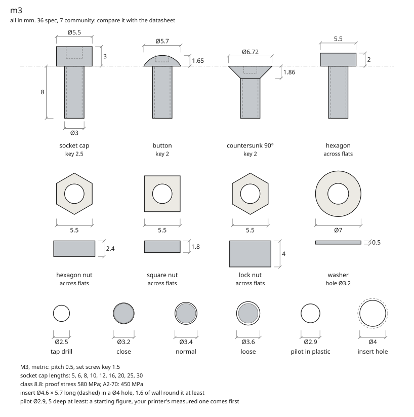
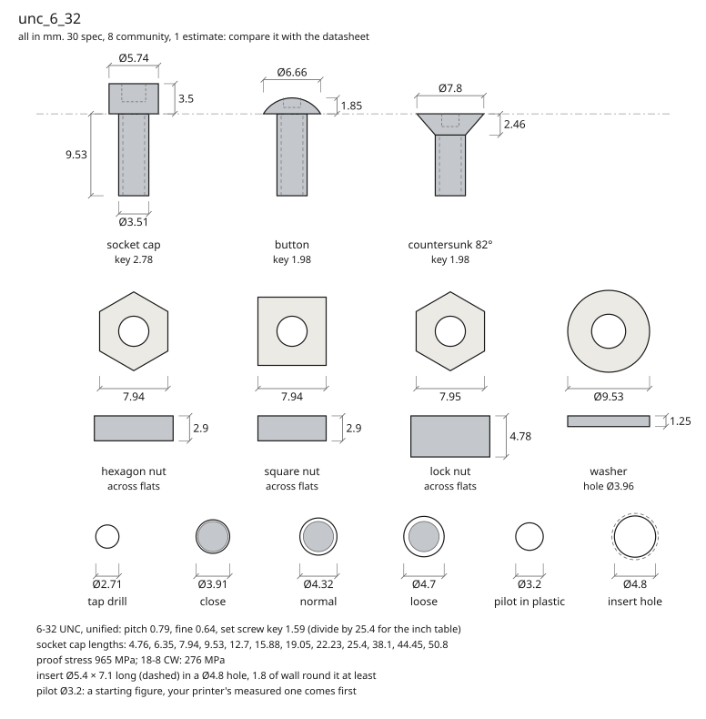

# @rulecad/rules

Researched facts for designing printed parts, as open data (CC0, public domain). Every value says what it is, where
it comes from and when it was checked, so a design built on it can be traced and corrected.

```json
"bed": { "value": 256, "unit": "mm", "rule": "Build volume is 256 × 256 × 256 mm", "kind": "spec",
         "source": "https://…", "checked": "2026-10-11" }
```

| Set | What | Values |
|---|---|---|
| `wire` | Hook-up wire by gauge: current density, service loop | 4 |
| `x1c` | Bambu Lab X1 Carbon: bed, line width, layer, overhang, bridges, fits, the gap parts printed in place need (and how far the first layer spreads), hole compensation, and the measured pilot for an M3 screw in PLA (`pilot_m3`) | 14 |
| `mx` | Cherry MX switches: plate cut-out, stem, housing, travel, key pitch | 29 |
| `oem` | OEM keycap profile: heights and top tilt per row (from KeyV2) | 12 |
| `pico` | Raspberry Pi Pico: outline, headers, the GPIO on each pin | 18 |
| `promicro` | Pro Micro controller | 9 |
| `sod123` | SOD-123 diode footprint | 3 |
| `xiao` | Seeed Studio XIAO modules: outline, headers, the pin on each pad | 8 |
| `qwiic` | Qwiic / STEMMA QT sockets (JST SH, 4 pins): land pattern and pinout | 10 |
| `jstph` | JST PH (2.0 mm) battery connector | 3 |
| `jlcpcb` | JLCPCB's limits for two-layer boards | 14 |
| `wiring` | Room for hand wiring | 1 |
| `nema17`, `nema14` | NEMA 17 (48 mm body, StepperOnline's drawing) and NEMA 14 steppers: frame, boss, D shaft, holes, torque, current, inductance. For a 40 mm NEMA 17 give its length and torque | 23, 23 |
| `28byj48` | The 28BYJ-48 5 V geared stepper: can, ears, the offset double-flat shaft, ratio, torque at the output | 28 |
| `n20` | An N20 gear motor (Pololu's 100:1 HP 6 V drawing and figures): section, D shaft, M1.6 holes, stall and free-running output | 23 |
| `sg90`, `mg90s` | 9 g and 13 g servos: case, tabs, holes, output, stall torque, speed and range | 24, 24 |
| `bldc2204` | A 2204 brushless gimbal motor, 260 KV: bell, hub, KV, current (its bolt pattern changes from maker to maker: measure yours) | 16 |
| `m1_6`, `m2`, `m2_5`, `m3`, `m4`, `m5`, `m6`, `m8`, `m10`, `m12` | ISO metric threads M1.6 to M12, one set each, with everything that hangs off the thread: pitch, tap drill, the three ISO 273 clearance holes, socket cap, button, countersunk and hexagon heads, hexagon, square and lock nuts, washer, set screw, the lengths sold, strength, a heat-set insert (M2 to M5) and a starting pilot in plastic | 30 to 46 each |
| `unc_4_40`, `unc_6_32`, `unc_8_32`, `unc_10_24`, `unf_10_32`, `unc_1_4_20`, `unc_5_16_18`, `unc_3_8_16` | Unified inch threads 4-40 to 3/8-16 to the same names, in millimetres, each rule's text giving its inch figure: ASME B1.1 threads, ASME B18.3 socket screws, with holes, nuts, washers and lengths | 39 to 49 each |
| `pt_k22`, `pt_k25`, `pt_k30`, `pt_k35`, `pt_k40`, `pt_k50` | Thread-forming screws for plastic (the PT type, WN 1412), 2.2 to 5 mm: thread, pan head with a Torx variant, and the maker's pilot, depth and boss for ABS. Community until measured in printed plastic | 11 each |
| `engagement` | How much thread a screw needs in what it screws into, in screw diameters: steel, aluminium, plastic | 3 |
| `rp2040` | The RP2040 microcontroller: which package pins carry which GPIO | 2 |
| `dial-indicator` | A dial indicator with a plunger, for measuring small movements | 2 |
| `pla`, `petg` | Bambu Lab PLA Basic and PETG HF, printed, for analysis: stiffness and strength along the layers and across them | 6, 7 |
| `bearing-608`, `bearing-625`, `bearing-6800`, `bearing-f623`, `bearing-51104` | Ball bearings from NTN's figures: 608, 625, 6800, the flanged F623 and the 51104 thrust bearing: bore, outer diameter, width, chamfer, ratings, radial play class | 9, 9, 9, 10, 10 |
| `bearing-mr105` | MR105 miniature bearing, 5 x 10 mm (4 wide shielded, 3 open), distributor figures: community until measured | 8 |
| `endstop-10t85` | The lever microswitch endstop marked 10T85: body, holes, force. Community until measured, and its lever travel is not published anywhere found | 12 |
| `as5600` | AS5600 magnetic encoder board and its 6 mm diametric magnet: resolution, air gap, field, board size | 15 |
| `a4988`, `drv8825`, `tmc2209` | Stepper driver modules on the StepStick footprint: voltages, current with and without cooling, sense resistor, Vref formula and gain, microsteps, header spacing, pinout. The TMC2209's module figures are community until measured | 18, 18, 19 |
| `cnc-shield-v3` | Arduino CNC shield V3: step, direction, enable and limit pins on the Uno, the Z limit quirk between revisions, A axis jumpers, microstep jumpers. Community until measured | 19 |
| `supply-12v`, `supply-24v` | Enclosed 12 V and 24 V switching supplies by current (Mean Well's LRS series as variants): current, power, case size. Community until measured | 7, 8 |
| `t8-screw` | T8 trapezoidal lead screw, 8 mm, 2 mm pitch: 8 mm lead (Tr8x8(P2)), with variants for 2 and 4 mm leads; helix, an efficiency note and an assumed friction. Community until measured | 10 |
| `t8-nut` | Flanged nut for a T8 screw: brass drawing (flange, body, hole circle), POM variant by material only. Community until measured | 12 |
| `rod-8` | 8 mm hardened ground linear shaft: diameter, tolerance, hardness. Community until measured | 5 |
| `lm8uu`, `lm8luu` | Linear ball bushings 8 x 15 x 24 and 8 x 15 x 45: bore, outer diameter, length, ratings (Samick's figures from distributors). Community until measured | 6, 6 |
| `coupler-5-8` | 5 mm to 8 mm flexible coupler: bores, length, outer diameter. Community until measured | 5 |
| `gt2-belt-6` | GT2 (2MGT) belt, 6 mm wide: pitch, pitch line offset, width, stiffness per unit strain and per width, rated tension, smallest idlers (Gates's figures; unbranded belt community until measured) | 11 |
| `pulley-gt2-16`, `pulley-gt2-20` | GT2 16 and 20 tooth pulleys for 6 mm belt with a 5 mm bore: teeth, pitch and tooth diameters (Gates's), bore, rim, width. Community until measured, Gates's own sprockets as variants | 8, 8 |
| `idler-gt2-toothed-20`, `idler-gt2-smooth-20` | GT2 idlers with bearings for 6 mm belt, 5 mm bore, toothed and smooth. Community until measured | 6, 5 |
| `al6061`, `al7075`, `s275`, `ss304`, `ti64` | Aluminium 6061-T6 and 7075-T6, structural steel S275, stainless 304, titanium Ti-6Al-4V, for analysis | 4 or 5 each |

`kind` says how far to trust a value: **spec** (a datasheet or manufacturer), **community** (a widely used figure, such
as KiCad's library or KeyV2), **default** (a setting that works), **derived** (read off someone else's model with `cad measure`: check it
against the real thing, and see its `licence`), or **estimate** (nobody has published it: measure it and correct it). Use them with `@rulecad/variables` (`uses: ['x1c']`, then `x1c.line * 3` in any expression), or read
the JSON from anywhere.

**Shared names.** A set that describes a part (`"part": "motor"`, or bearing, switch, encoder, driver, board, supply, leadscrew, nut, rod, linear_bearing, coupler, belt, pulley, idler, thread) uses the names in [`vocabulary.json`](vocabulary.json):
`body_*`, `boss_*`, `shaft_*`, `mount_*`, `cable_*` and the rest, each in its unit, so one piece of code can read any of
them. An older set keeps its own names and says which is which (`"interface": { "body_length": "length" }`). `cad rules
check` holds every set to all this. `cad rules draw nema17` draws what a set says the part mounts by, for comparing with
its datasheet by eye:


Bearings, linear bearings, nuts, couplers, pulleys and idlers draw as an end view and a section (bore, outer diameter, width or length, any flange and hole circle), a lead screw from the side with pitch against lead, a belt as a short length with its pitch, and driver modules as the board with its two header rows at their spacing, so a bought part can be held against its datasheet the same way.

**Threads.** Each thread size is one set with `"part": "thread"`, holding everything that hangs off that thread under
the same names whatever the size, so `m3.clearance`, `m8.clearance` and `unc_1_4_20.clearance` mean the same thing.

| Names | What | From |
|---|---|---|
| `thread_form`, `thread`, `major_diameter`, `pitch`, `pitch_fine`, `tap_drill` | The thread: `metric`, `unified` or `plastic`, as it is written (`M3`, `6-32 UNC`), its diameter and pitch, and the drill for tapping it | ISO 261, ISO 262, ISO 2306; ASME B1.1 |
| `clearance_close`, `clearance`, `clearance_loose` | Clearance holes. `clearance` is the normal fit | ISO 273; ASME B18.2.8 |
| `head`, `head_height`, `head_key` | The socket head cap screw | ISO 4762; ASME B18.3 |
| `button_head`, `button_head_height`, `button_key` | The button head socket screw | ISO 7380-1; ASME B18.3 |
| `countersunk_head`, `countersunk_head_height`, `countersunk_angle`, `countersunk_key` | The countersunk socket screw: 90° metric, 82° inch | ISO 10642; ASME B18.3 |
| `hex_head_flats`, `hex_head_height` | The hexagon head screw | ISO 4017; ASME B18.2.1 |
| `nut_flats`, `nut_height`, `square_nut_flats`, `square_nut_height`, `lock_nut_flats`, `lock_nut_height` | Hexagon, thin square and nylon-insert lock nuts | ISO 4032, DIN 562, DIN 985; ASME B18.2.2, B18.6.3 |
| `washer_bore`, `washer_diameter`, `washer_thickness` | The plain washer | ISO 7089; ASME B18.21.1 |
| `set_screw_key`, `set_screw_point` | The socket set screw | ISO 4026; ASME B18.3 |
| `lengths` | The lengths a socket head cap screw is sold in: a list | ISO 4762; a named catalogue for inch |
| `property_class`, `proof_stress`, `stainless_class`, `stainless_proof_stress` | Strength: steel, then stainless as a second figure | ISO 898-1, ISO 3506-1; ASTM A574 |
| `insert_diameter`, `insert_length`, `insert_hole`, `insert_depth`, `insert_wall` (`insert_taper` where a maker asks for one) | A heat-set insert and the straight hole it melts into, `community`. Shorter inserts of the same thread are `variants` | CNC Kitchen's dimensions and design guidelines sheet |
| `pilot`, `pilot_depth`, `pilot_boss` | A starting hole, as drawn, for the screw to form its own thread in printed plastic: `community` for M2 to M4, and an `estimate` for the sizes with no published figure. A printer's measured figure comes first: `x1c.pilot_m3` | Bambu Lab's guide to screw holes; PSM's sheet for thread-forming screws |

A size carries only what its standard makes in that size: there is no M2 button head in ISO 7380-1, so `m2` has no
`button_head`. The names designs have read since the first release keep their values: `clearance` is the ISO 273
normal hole, `head` and `head_height` the ISO 4762 head, `nut_flats` and `nut_height` the ISO 4032 nut. Where an older
DIN and the current ISO disagree (a 16 mm M10 nut where DIN 934 made it 17), the set holds the ISO figure and its rule
says so: measure the nuts you have before cutting a pocket for them.

`lengths` is a list: `"value": [5, 6, 8, 10, 12, 16, 20, 25, 30]`. A design reads it as an array (`v.m3.lengths`), and
an expression takes `min(m3.lengths)` or `max(m3.lengths)`.

`cad rules check` holds a thread to its vocabulary and to sense: a head wider than its loosest clearance hole, a tap
drill close to the major diameter less the pitch, holes in the order close, normal, loose, and lengths ascending.
`cad rules draw m3` draws the screw in each head form the size is made in, its nuts and washer, and its holes:



A screw made for plastic (`pt_k30`: the PT type, 3 mm) is a thread set too, with `"thread_form": "plastic"`, its pan
head (`pan_head`, `pan_head_height`, `pan_head_drive`, and a `torx` variant), its `root_diameter`, and its maker's
pilot, depth and boss for ABS. It has no tap drill and no nut. `engagement` holds how much thread a screw needs in
steel, aluminium and plastic, in screw diameters: `m3.major_diameter * engagement.plastic`.

An inch set holds millimetres like every other set, and each rule's text gives the inch figure it came from, so
`unc_6_32.head` is 5.74 and its rule reads "at most: 0.226 in". `cad rules draw unc_6_32` draws the screw a PC case
uses:



`cad rules draft mymotor --from datasheet.pdf` pulls the figures out of a datasheet's text for you to name and check. It
marks every one `estimate`, and many datasheets are pictures it can't read at all: a person reads the datasheet, the
check and the drawing are how they catch a slip.

**Corrections are the most useful contribution.** If you measured something, use the "Correct a rule" issue form on
GitHub, or open a pull request with the value,
`"kind": "measured"`, how you measured it, and the date.
