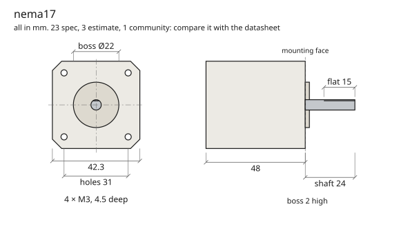

# @rulecad/rules

Researched facts for designing printed parts, as open data (CC0, public domain). Every value says what it is, where
it comes from and when it was checked, so a design built on it can be traced and corrected.

```json
"bed": { "value": 256, "unit": "mm", "rule": "Build volume is 256 × 256 × 256 mm", "kind": "spec",
         "source": "https://…", "checked": "2026-10-11" }
```

| Set | What | Values |
|---|---|---|
| `wire` | Hook-up wire by gauge: current density, service loop | 4 |
| `x1c` | Bambu Lab X1 Carbon: bed, line width, layer, overhang, bridges, fits, the gap parts printed in place need (and how far the first layer spreads), and hole compensation | 13 |
| `mx` | Cherry MX switches: plate cut-out, stem, housing, travel, key pitch | 29 |
| `oem` | OEM keycap profile: heights and top tilt per row (from KeyV2) | 12 |
| `m2` | M2 heat-set inserts and screws | 5 |
| `pico` | Raspberry Pi Pico: outline, headers, the GPIO on each pin | 18 |
| `promicro` | Pro Micro controller | 9 |
| `sod123` | SOD-123 diode footprint | 3 |
| `xiao` | Seeed Studio XIAO modules: outline, headers, the pin on each pad | 8 |
| `qwiic` | Qwiic / STEMMA QT sockets (JST SH, 4 pins): land pattern and pinout | 10 |
| `jstph` | JST PH (2.0 mm) battery connector | 3 |
| `jlcpcb` | JLCPCB's limits for two-layer boards | 14 |
| `wiring` | Room for hand wiring | 1 |
| `m4`, `m5` | M4 and M5 socket head screws and hex nuts | 5 each |
| `nema17`, `nema14` | NEMA 17 (48 mm body, StepperOnline's drawing) and NEMA 14 steppers: frame, boss, D shaft, holes, torque, current, inductance. For a 40 mm NEMA 17 give its length and torque | 23, 23 |
| `28byj48` | The 28BYJ-48 5 V geared stepper: can, ears, the offset double-flat shaft, ratio, torque at the output | 28 |
| `n20` | An N20 gear motor (Pololu's 100:1 HP 6 V drawing and figures): section, D shaft, M1.6 holes, stall and free-running output | 23 |
| `sg90`, `mg90s` | 9 g and 13 g servos: case, tabs, holes, output, stall torque, speed and range | 24, 24 |
| `bldc2204` | A 2204 brushless gimbal motor, 260 KV: bell, hub, KV, current (its bolt pattern changes from maker to maker: measure yours) | 16 |
| `m1_6`, `m3` | M1.6 and M3 screws for motor faces | 3 each |
| `rp2040` | The RP2040 microcontroller: which package pins carry which GPIO | 2 |
| `dial-indicator` | A dial indicator with a plunger, for measuring small movements | 2 |
| `pla`, `petg` | Bambu Lab PLA Basic and PETG HF, printed, for analysis: stiffness and strength along the layers and across them | 6, 7 |
| `bearing-608`, `bearing-625`, `bearing-6800`, `bearing-f623`, `bearing-51104` | Ball bearings from NTN's figures: 608, 625, 6800, the flanged F623 and the 51104 thrust bearing: bore, outer diameter, width, chamfer, ratings, radial play class | 9, 9, 9, 10, 10 |
| `bearing-mr105` | MR105 miniature bearing, 5 x 10 mm (4 wide shielded, 3 open), distributor figures: community until measured | 8 |
| `endstop-10t85` | The lever microswitch endstop marked 10T85: body, holes, force. Community until measured, and its lever travel is not published anywhere found | 12 |
| `as5600` | AS5600 magnetic encoder board and its 6 mm diametric magnet: resolution, air gap, field, board size | 15 |
| `a4988`, `drv8825`, `tmc2209` | Stepper driver modules on the StepStick footprint: voltages, current with and without cooling, sense resistor, Vref formula and gain, microsteps, header spacing, pinout. The TMC2209's module figures are community until measured | 18, 18, 19 |
| `cnc-shield-v3` | Arduino CNC shield V3: step, direction, enable and limit pins on the Uno, the Z limit quirk between revisions, A axis jumpers, microstep jumpers. Community until measured | 19 |
| `supply-12v`, `supply-24v` | Enclosed 12 V and 24 V switching supplies by current (Mean Well's LRS series as variants): current, power, case size. Community until measured | 7, 8 |
| `t8-screw` | T8 trapezoidal lead screw, 8 mm, 2 mm pitch: 8 mm lead (Tr8x8(P2)), with variants for 2 and 4 mm leads; helix, an efficiency note and an assumed friction. Community until measured | 10 |
| `t8-nut` | Flanged nut for a T8 screw: brass drawing (flange, body, hole circle), POM variant by material only. Community until measured | 12 |
| `rod-8` | 8 mm hardened ground linear shaft: diameter, tolerance, hardness. Community until measured | 5 |
| `lm8uu`, `lm8luu` | Linear ball bushings 8 x 15 x 24 and 8 x 15 x 45: bore, outer diameter, length, ratings (Samick's figures from distributors). Community until measured | 6, 6 |
| `coupler-5-8` | 5 mm to 8 mm flexible coupler: bores, length, outer diameter. Community until measured | 5 |
| `gt2-belt-6` | GT2 (2MGT) belt, 6 mm wide: pitch, pitch line offset, width, stiffness per unit strain and per width, rated tension, smallest idlers (Gates's figures; unbranded belt community until measured) | 11 |
| `pulley-gt2-16`, `pulley-gt2-20` | GT2 16 and 20 tooth pulleys for 6 mm belt with a 5 mm bore: teeth, pitch and tooth diameters (Gates's), bore, rim, width. Community until measured, Gates's own sprockets as variants | 8, 8 |
| `idler-gt2-toothed-20`, `idler-gt2-smooth-20` | GT2 idlers with bearings for 6 mm belt, 5 mm bore, toothed and smooth. Community until measured | 6, 5 |
| `al6061`, `al7075`, `s275`, `ss304`, `ti64` | Aluminium 6061-T6 and 7075-T6, structural steel S275, stainless 304, titanium Ti-6Al-4V, for analysis | 4 or 5 each |

`kind` says how far to trust a value: **spec** (a datasheet or manufacturer), **community** (a widely used figure, such
as KiCad's library or KeyV2), **default** (a setting that works), **derived** (read off someone else's model with `cad measure`: check it
against the real thing, and see its `licence`), or **estimate** (nobody has published it: measure it and correct it). Use them with `@rulecad/variables` (`uses: ['x1c']`, then `x1c.line * 3` in any expression), or read
the JSON from anywhere.

**Shared names.** A set that describes a part (`"part": "motor"`, or bearing, switch, encoder, driver, board, supply, leadscrew, nut, rod, linear_bearing, coupler, belt, pulley, idler) uses the names in [`vocabulary.json`](vocabulary.json):
`body_*`, `boss_*`, `shaft_*`, `mount_*`, `cable_*` and the rest, each in its unit, so one piece of code can read any of
them. An older set keeps its own names and says which is which (`"interface": { "body_length": "length" }`). `cad rules
check` holds every set to all this. `cad rules draw nema17` draws what a set says the part mounts by, for comparing with
its datasheet by eye:



Bearings, linear bearings, nuts, couplers, pulleys and idlers draw as an end view and a section (bore, outer diameter, width or length, any flange and hole circle), a lead screw from the side with pitch against lead, a belt as a short length with its pitch, and driver modules as the board with its two header rows at their spacing, so a bought part can be held against its datasheet the same way.

`cad rules draft mymotor --from datasheet.pdf` pulls the figures out of a datasheet's text for you to name and check. It
marks every one `estimate`, and many datasheets are pictures it can't read at all: a person reads the datasheet, the
check and the drawing are how they catch a slip.

**Corrections are the most useful contribution.** If you measured something, use the "Correct a rule" issue form on
GitHub, or open a pull request with the value,
`"kind": "measured"`, how you measured it, and the date.
