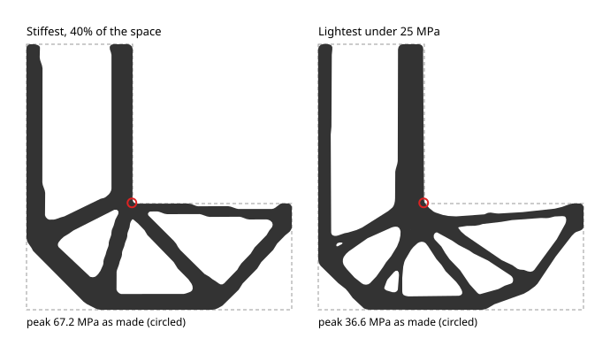

# @rulecad/topopt

Topology optimisation for flat parts (2D) and solid ones (3D): where to put a fixed amount of material in a region so
the part is as stiff as possible under its loads. Give it the space a part may fill, the bosses it must keep, the
holes it must avoid, where it's held and how it's loaded. It returns outlines ready to extrude (2D), or a closed surface
ready to print (3D). No dependencies but
[@rulecad/fea](../fea); runs in browsers and Node.

```js
import { discretise, optimise, outlines } from '@rulecad/topopt';

const spec = discretise({
  space: { at: [60, 0], size: [140, 40] },                         // where material may go (mm)
  keep: [{ at: [0, 0], r: 6 }, { at: [120, 0], r: 5 }],            // must stay solid
  avoid: [{ at: [0, 0], r: 2.8 }, { at: [120, 0], r: 2.3 }],       // must stay empty
  supports: [{ at: [0, 0], r: 2.8 }],                              // held here
  loads: [{ at: [120, 0], r: 2.3, force: [0, -20], case: 'down' }], // pushed here (N)
  material: { E: 2680, nu: 0.36 }, thickness: 6, cell: 1, volume: 0.5, filter: 2.5,
});
const result = optimise(spec, { onStep: (s) => console.log(s.step, s.compliance) });
result.unsupported; // with overhang: the share of the kept regions' material nothing holds up (0: all held up)
result.cases;      // [{ name: 'down', deflection (mm along the load), stiffness (N/mm) }]; a twist (forces adding
                   // to nothing): { name, moment (N·mm), angle (radians), torsion (N·mm a radian) }
const loops = outlines(spec.grid, result.density, spec.origin);   // closed loops, solid on the left
```

### In 3D

Regions take a z. A region can be a box (`size`), a cylinder (`r`, `length`, `axis`), a ball (`r`), or a closed
triangle mesh (`triangles`). A cylinder can be a teardrop: `teardrop: '-z'` for a boss, `'+z'` for a hole, or any
direction across its axis. It gets a 45° point that way, so it prints without support. Supports and loads can be any region.

```js
const spec = discretise({
  space: { at: [10, 0, 43], size: [40, 40, 86] },
  keep: [{ at: [10, 0, 80], r: 5, length: 16, axis: 'x', teardrop: '-z' }],
  supports: [{ at: [10, 0, 1], size: [40, 40, 2] }],
  loads: [{ at: [10, 0, 80], r: 2.4, length: 16, axis: 'x', force: [0, -20, 0] }],
  material: { E: 2680, nu: 0.36 }, cell: 2.5, volume: 0.2, filter: 5,
  overhang: '+z',                                    // printable standing this way up: no supports
});
const result = optimise(spec);                       // multigrid solves each step
const { vertices, faces } = surface(spec.grid, result.density, spec.origin, { overhang: { up: '+z', angle: 45 } });
```

## How it works

The density method (SIMP: solid isotropic material with penalisation). Each cell has a density from 0 to 1, starting
even. On each step:

1. **Analyse** the part (@rulecad/fea).
2. **Work out each cell's effect on the compliance.** Compliance is how much the part gives under its loads, so lower
   is stiffer; each cell's effect is its gradient.
3. **Move material** towards the cells that stiffen the part most, keeping the total fixed (the optimality criteria
   update).

Stiffness grows as density cubed, so part-solid cells are poor value and the result settles into solid and empty.
Two more steps shape the result:

- **A density filter** averages each cell with its neighbours. It sets the thinnest member and prevents chequerboard
  patterns.
- **Heaviside projection** sharpens the result, more on each pass, until cells are solid or empty.
- **The overhang filter** (optional, after Langelaar 2017) applies the printer's limit. Layer by layer from the bed, a
  cell can only be as solid as the material under it: the cell below and its neighbours, so nothing overhangs more
  than 45°. The result prints without supports in that direction. Kept regions must print too: a kept cell that
  nothing holds up costs the optimiser as much as the whole part's compliance (shared over the kept cells), so it grows
  what holds it up; `result.unsupported` says how much of the kept material is still left hanging, which means there
  wasn't material enough to stand it on.

Several load cases are optimised together by weight. A case weighted 0 is solved only at the end, for its figures.
`model(spec)` exposes the analysis and its gradient, for other update methods.

`outlines` traces a 2D result's edges at density 0.5 (marching squares), smooths them (Taubin, which keeps the size),
and drops holes and islands smaller than `minArea`.

`surface` does the same for a 3D result: a closed triangle mesh at density 0.5, by marching tetrahedra. Every cube
is split along the same diagonal, so neighbouring cubes cut their shared faces the same way and the surface has no
gaps. Then it's smoothed. With `overhang`, the smoothed surface is made printable: faces left steeper than the limit
are tipped back to it, and tips left hanging in mid-air (the lowest point of a dip under an edge, which a printer has
nothing to lay down on) are lifted level with their neighbours, in turn until neither finds any.

`printable` makes a result printable before it's drawn, the hard way: built up layer by layer from the bed, a cell
stays only if something holds it up (a cell in the layer below, straight under it or diagonally next to that; or,
within `reach` cells along its own layer, one that is: a short bridge); kept regions always stay. Whatever's left
hanging is emptied, and with it, layer by layer, whatever rested on it. It's what `cad optimise` does to every 3D
result with a build direction.

## Stress limits

Stiffness alone puts material in sharp inside corners, where stress concentrates and cracks start. Give a stress limit
(MPa) instead of a volume, and `optimise` finds the lightest layout that keeps every cell's von Mises stress under it:

```js
const spec = discretise({ ...problem, volume: undefined, stress: 13 }); // pla.strength / 3
const result = optimise(spec);
result.stress;     // { peak, limit }: the largest stress in the result's solid cells (MPa)
```

- **How:** each cell's stress at its centre, as if solid, gets its own limit, scaled by its density so an empty cell's
  limit vanishes (Senhora, Giraldo-Londoño, Menezes, Paulino 2020). An augmented Lagrangian keeps them all: every 5
  steps its multipliers are raised where a limit is broken, and its penalty grows. Each step is a step of the method
  of moving asymptotes (`mma`, after Svanberg's 2007 code, also exported), and needs one more solve, for the adjoint.
- **Cost:** about a thousand steps, each with two solves, against about two hundred with one for the stiffest layout.
  Start on coarse cells.
- **Supports and loads:** every cell is limited, those where the part is held and loaded too, so give them some area
  (a hole's edge, a pad): a force on a point is an unlimited stress there.

The L-bracket (`reference/lbracket.mjs`), the usual test: a 100 mm square less its top-right 60 mm, held along the
top of its upright arm and pushed down with 100 N at the end of its lower one, PLA 2 mm thick, on 1 mm cells. Each
result is re-analysed as it would be made: its smoothed outline, on 0.5 mm cells.

| | Space used | Compliance | Peak stress, on its cells | Peak stress, as made |
|---|---|---|---|---|
| Stiffest at 40% | 40.0% | 373 N·mm | – | 67.2 MPa |
| Lightest under 25 MPa | 39.4% | 426 N·mm | 26.2 MPa | 36.6 MPa |



For the same material, the stress-limited bracket draws its members together with filleted joints, and its peak stress
falls by 46%. Two things to know:

- **A sharp corner in the space stays sharp.** The domain's inside corner is where both arms meet, and both results
  keep material there; on finer cells its stress keeps rising. The limit holds to within 5% on the optimiser's own
  cells, not on finer ones. Check the final part on finer cells (cad's `analysis` with a `cell`), and set the limit
  with that margin in mind.
- **It may not settle within its steps.** This one ran its 1,000 steps with the peak hovering 5% over the limit.

## Checked against the published code

With projection off, it matches a line-by-line port of the 88-line MATLAB code (`reference/top88.py`) step for step:

- **The MBB beam** (60 × 20, volume 0.5): 127 steps to a compliance of 218.80.
- **A short cantilever** (48 × 24, volume 0.4): 100 steps to 99.49.

In 3D it matches a port of Liu and Tovar's top3d (`reference/top3d.py`) step for step: a cantilever of 24 × 8 × 8
cubes, 145 steps to 4906.73. The overhang filter's gradient agrees with finite differences.

Its gradients agree with finite differences through the filter and the projection.

## Glossary

- **Compliance:** the load times how far it moves (N·mm); the inverse of stiffness.
- **Volume:** the share of the space the result fills, 0 to 1.
- **Filter radius:** about the thinnest member, in mm.
- **Von Mises stress:** one number for how hard a point of material is worked, from all its stresses together; it's
  compared with the material's strength.

## Sources

- Bendsøe, Sigmund (2003). *Topology Optimization: Theory, Methods and Applications*. Springer.
- Andreassen, Clausen, Schevenels, Lazarov, Sigmund (2011). Efficient topology optimization in MATLAB using 88 lines
  of code. *Structural and Multidisciplinary Optimization* 43, 1–16.
- Wang, Lazarov, Sigmund (2011). On projection methods, convergence and robust formulations in topology optimization.
  *Structural and Multidisciplinary Optimization* 43, 767–784.
- Liu, Tovar (2014). An efficient 3D topology optimization code written in Matlab. *Structural and Multidisciplinary
  Optimization* 50, 1175–1196.
- Langelaar (2017). An additive manufacturing filter for topology optimization of print-ready designs. *Structural and
  Multidisciplinary Optimization* 55, 871–883.
- Taubin (1995). A signal processing approach to fair surface design. *SIGGRAPH '95*, 351–358.
- Senhora, Giraldo-Londoño, Menezes, Paulino (2020). Topology optimization with local stress constraints: a stress
  aggregation-free approach. *Structural and Multidisciplinary Optimization* 62, 1639–1668.
- Svanberg (1987). The method of moving asymptotes: a new method for structural optimization. *International Journal
  for Numerical Methods in Engineering* 24, 359–373.
