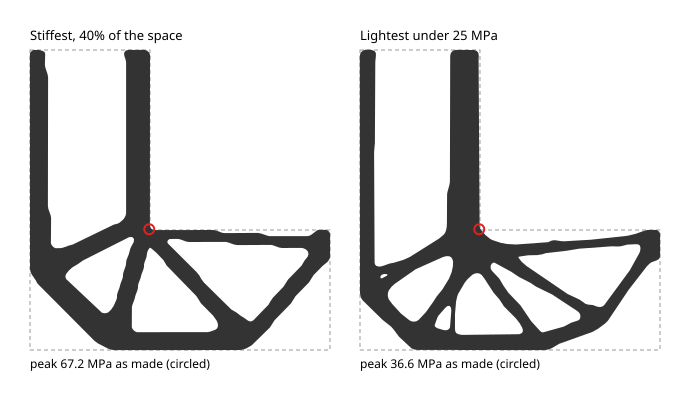

# @rulecad/topopt

Topology optimisation for flat parts (2D) and solid ones (3D): where to put a fixed amount of material in a region so
the part is as stiff as possible under its loads. Give it the space a part may fill, the bosses it must keep, the
holes it must avoid, where it's held and how it's loaded. It returns outlines ready to extrude (2D), or a closed surface
ready to print (3D). No dependencies but
[@rulecad/fea](../fea); runs in browsers and Node.

```js
import { discretise, optimise, outlines } from '@rulecad/topopt';

const spec = discretise({
  space: { at: [60, 0], size: [140, 40] },                         // where material may go (mm)
  keep: [{ at: [0, 0], r: 6 }, { at: [120, 0], r: 5 }],            // must stay solid
  avoid: [{ at: [0, 0], r: 2.8 }, { at: [120, 0], r: 2.3 }],       // must stay empty
  supports: [{ at: [0, 0], r: 2.8 }],                              // held here
  loads: [{ at: [120, 0], r: 2.3, force: [0, -20], case: 'down' }], // pushed here (N)
  material: { E: 2680, nu: 0.36 }, thickness: 6, cell: 1, volume: 0.5, filter: 2.5,
});
const result = optimise(spec, { onStep: (s) => console.log(s.step, s.compliance) });
result.unsupported; // with overhang: the share of the kept regions' material nothing holds up (0: all held up)
result.cases;      // [{ name: 'down', deflection (mm along the load), stiffness (N/mm) }]; a twist (forces adding
                   // to nothing): { name, moment (N·mm), angle (radians), torsion (N·mm a radian) }
const loops = outlines(spec.grid, result.density, spec.origin);   // closed loops, solid on the left
```

### In 3D

Regions take a z. A region can be a box (`size`), a cylinder (`r`, `length`, `axis`), a ball (`r`), or a closed
triangle mesh (`triangles`). A cylinder can be a teardrop: `teardrop: '-z'` for a boss, `'+z'` for a hole, or any
direction across its axis. It gets a 45° point that way, so it prints without support. Supports and loads can be any region.

A part's mesh can be a region of a flat problem too: `{ triangles, flat: true }` is its section halfway up (a plate's
outline, its holes open), so a flat part can be optimised within the blank it's cut from.

```js
const spec = discretise({
  space: { at: [10, 0, 43], size: [40, 40, 86] },
  keep: [{ at: [10, 0, 80], r: 5, length: 16, axis: 'x', teardrop: '-z' }],
  supports: [{ at: [10, 0, 1], size: [40, 40, 2] }],
  loads: [{ at: [10, 0, 80], r: 2.4, length: 16, axis: 'x', force: [0, -20, 0] }],
  material: { E: 2680, nu: 0.36 }, cell: 2.5, volume: 0.2, filter: 5,
  overhang: '+z',                                    // printable standing this way up: no supports
});
const result = optimise(spec);                       // multigrid solves each step
const { vertices, faces } = surface(spec.grid, result.density, spec.origin, { overhang: { up: '+z', angle: 45 } });
```

## How it works

The density method (SIMP: solid isotropic material with penalisation). Each cell has a density from 0 to 1, starting
even. On each step:

1. **Analyse** the part (@rulecad/fea).
2. **Work out each cell's effect on the compliance.** Compliance is how much the part gives under its loads, so lower
   is stiffer; each cell's effect is its gradient.
3. **Move material** towards the cells that stiffen the part most, keeping the total fixed (the optimality criteria
   update).

Stiffness grows as density cubed, so part-solid cells are poor value and the result settles into solid and empty.
Two more steps shape the result:

- **A density filter** averages each cell with its neighbours. It sets the thinnest member and prevents chequerboard
  patterns. A member thinner than four cells is analysed too stiff (two cells: about 11%; one: about
  32%; see @rulecad/fea, How fine a grid), so pick a cell small enough that the thinnest member the filter allows is
  four cells across, or a result full of thin members looks better than it is.
- **Heaviside projection** sharpens the result, more on each pass, until cells are solid or empty.
- **The overhang filter** (optional, after Langelaar 2017) applies the printer's limit. Layer by layer from the bed, a
  cell can only be as solid as the material under it: the cell below and its neighbours, so nothing overhangs more
  than 45°. With `bridge` (the widest gap the printer spans, mm), a cell is also held up by a bridge: a run of solid
  cells along its own layer, up to half that long, ending on a held cell. The result prints without supports in that
  direction. Kept regions must print too: a kept cell that
  nothing holds up costs the optimiser as much as the whole part's compliance (shared over the kept cells), so it grows
  what holds it up; `result.unsupported` says how much of the kept material is still left hanging, which means there
  wasn't material enough to stand it on.

- **Process filters** (optional) hold the result to what another way of making it can make. `mill: '+z'` (the tool
  cuts from that side) and `cast: '+z'` (a mould drawn off that way) make each cell as solid as every cell between
  it and that side, by a smooth running maximum along each line (`drawFilter`, never below the larger of the two
  densities it joins and never above 1), so nothing is undercut. With
  `cast: { draw: 'z', parting }` the mould is in two halves, drawn off both ways from the parting plane (mm; the
  space's middle by default). `symmetry: { mirror: 'xy', turns: 4, axis: 'z' }` and `extrude: 'x'` tie cells
  together (`tieFilter`): each design density is the average over its mirror images, its copies turned about the
  middle, or its line along the axis, so the part is the same in each. The mirror planes are the grid's middle
  planes, which are the middle of the space and keep regions (in 3D, except along an overhang's build direction).
  A mirror or turn that swaps the tool's side, the draw or the build direction for its opposite, or a quarter turn
  that moves it onto another axis, is refused by name: the part would have to be made from both sides at once. A
  mould in two halves parted at the grid's middle maps onto itself, so it may be mirrored or half turned across its
  draw. A process filter goes after the density filter and before the projection, in
  place of the overhang filter: a part is printed, milled or cast, one of them.
  `undercuts(grid, density, { from, parting })` counts the cells a tool or a mould half could not reach (none, by
  construction, unless an avoid region or the space's own edge sits behind material); `grey(density, passive)` is
  the share of the design cells between a tenth and nine tenths solid. A clear result has a few per cent, on its
  surfaces. A section milled, cast or extruded across its own plane in 2D often comes out grey (a grey column bends as
  stiffly as a solid one of its share's height, so the optimiser has no reason to choose), and its outline at half
  density is then a guess; `voids(grid, density)` finds enclosed empty pockets,
  which a powder bed print can't empty of powder, with each one's volume and centre.
- **The tool, more sides, the draft** (with a process filter). `tool` (mm, with `mill`) is a flat end mill's radius:
  in each layer across the tool's axis the part is closed by a disc that size (`toolFilter`: dilated then eroded,
  Sigmund 2007's morphology filters as smooth maxima and minima), so no pocket is narrower than the tool and every
  inside corner seen from it is rounded to its radius. In 2D, `mill: '+z'` with a tool is a plate's profile cut
  through by an end mill along z. `mill: ['+z', '-z']` mills from several sides, a setup each (Langelaar 2019): a
  cell stays only where no side's tool reaches it, the smooth minimum of what each side leaves. `draft` (degrees, with
  `cast`) narrows the part towards the side it is drawn off: a wall steps out a cell every whole number of layers in
  1 / tan(draft), so at least the draft asked, and a grid too shallow for one step is refused by name.
- **Voids prevented** (`voids: 'prevented'`): every empty pocket is kept open to the outside as the part is optimised,
  by the virtual temperature (`virtualTemperature`, Liu and others 2015): empty cells make heat and conduct it well,
  solid ones conduct it poorly, the grid's faces are held cold, so an enclosed void runs hot. Its p-mean is kept under
  a cap as a second constraint. On a twisted block that closes into a tube freely, the prevented run vents it for a
  little stiffness (test). For the stiffest part that fills a volume.
- **The thinnest member** (`feature`, mm): a printer's two lines, a resin printer's smallest feature. Members
  narrower go as the part is optimised: after the density filter the part is opened by a ball (`featureFilter`:
  eroded then dilated) of the least whole number of cells r whose 2r + 1 cells across are as wide. Where a cell is
  already as wide (two 0.42 mm lines on 1 mm cells), every member is, and nothing changes. A ball of one cell holds
  members to three cells; a wider one is refused by name with the cells that would do it, since a 2D cantilever
  optimised under a ball of two cells came out speckled with loose cells and over twice as flexible (450 against 199).
  On a 60 × 20 cantilever with a 1.2 mm filter, a 3 mm feature on 1 mm cells took the cells in members under three
  cells from 114 to none, for 8.8% more compliance (test). `thin(grid, density, { radius })` finds the solid cells in
  members narrower than a ball (and on square outside corners, which it rounds).

Milled from above, the 3D cantilever (24 × 8 × 8 cubes, volume 0.3, 200 steps) has no undercuts from the tool's
side and a compliance of 3227 against 2989 optimised freely, 8% less stiff, with 5.3% of its cells grey; the free
design has over 100 cells hidden under material from above. A 2D cantilever (30 × 20 squares, 200 steps) milled from
its top edge has no undercuts either, but over 30% of it is grey. Mirrored across its middle, a cantilever loaded at one corner comes out the same both
sides to the last digit.

| Figure | Formula | Source |
|---|---|---|
| Smooth maximum over a disc or ball of N cells | (1/β) ln(Σ exp(β x) / N), β = 10 ln N + 10 | Sigmund (2007) |
| Smooth minimum | 1 − smooth maximum of (1 − x) | Sigmund (2007) |
| Tool (closing) | smooth minimum of the smooth maximum, over a disc of the tool's radius in each layer | Sigmund (2007); Langelaar (2019) |
| Feature (opening) | smooth maximum of the smooth minimum, over a ball of r cells; r = ⌈(feature / h − 1) / 2⌉ | Sigmund (2007) |
| Several sides | smooth minimum of two: ½(a + b − √((a − b)² + ε)) + ½√ε, ε = 10⁻⁶ | Langelaar (2019) |
| Draft | a cell's step out every ⌊1 / tan(draft)⌋ layers | the draw after Gersborg and Andreassen (2011); the step is this package's choice |
| Virtual temperature | k = kₛ + (1 − kₛ)(1 − ρ)³, heat 1 − ρ, faces at 0; p-mean of T, p = 8 | Liu and others (2015) |

Several load cases are optimised together by weight. A case weighted 0 is solved only at the end, for its figures.
`model(spec)` exposes the analysis and its gradient, for other update methods.

`outlines` traces a 2D result's edges at density 0.5 (marching squares), smooths them (Taubin, which keeps the size),
and drops holes and islands smaller than `minArea`.

`surface` does the same for a 3D result: a closed triangle mesh at density 0.5, by marching tetrahedra. Every cube
is split along the same diagonal, so neighbouring cubes cut their shared faces the same way and the surface has no
gaps. Then it's smoothed. With `overhang`, the smoothed surface is made printable: faces left steeper than the limit
are tipped back to it, and tips left hanging in mid-air (the lowest point of a dip under an edge, which a printer has
nothing to lay down on) are lifted level with their neighbours, in turn until neither finds any.

`reduce` gives a closed surface fewer triangles. It collapses edges one at a time, cheapest first, by the quadric
error of Garland and Heckbert (1997): each corner keeps the planes of the faces it came from, and the sum of its squared
distances to them must stay under the tolerance squared, so no corner moves further than the tolerance from any of
those planes. A collapse is refused if it would open or pinch the surface (the two ends must share exactly the two
corners across their edge: the link condition of Dey and others, 1999), fold a face over, or leave a sliver with no
area. Corners on the grid's faces stay on them. Given the build direction and the printer's limit, it also refuses a
collapse that adds to the area hanging past the limit or leaves a corner lower than all its neighbours (a tip, which
slices as an island). On the bracket bench's printable result, 0.1 mm (a quarter of a print line) took 75,592
triangles to 21,124, the volume from 27.808 to 27.806 cm³, with no islands before or after.

```js
const fewer = reduce({ vertices, faces }, { tolerance: 0.1, lo, hi, overhang: { up: '+z', angle: 45 } }); // lo, hi: the grid's corners
```

| Figure | Formula | Source |
|---|---|---|
| A corner's error at p | Σ over its faces' planes (n · p + d)², n the unit normal | Garland and Heckbert (1997) |
| Collapse allowed | error ≤ tolerance², ends share exactly two corners, no face turned over 70° | Garland and Heckbert (1997); Dey and others (1999) |
| A face hangs | its normal points down more than sin(limit) from level, and it isn't on the bed | the printer's overhang limit, degrees from vertical |

`printable` makes a result printable before it's drawn, the hard way: built up layer by layer from the bed, a cell
stays only if something holds it up (a cell in the layer below, straight under it or diagonally next to that; or,
within `reach` cells along its own layer, one that is: a short bridge); kept regions always stay. Whatever's left
hanging is emptied, and with it, layer by layer, whatever rested on it. It's what `cad optimise` does to every 3D
result with a build direction.

## Stress limits

Stiffness alone puts material in sharp inside corners, where stress concentrates and cracks start. Give a stress limit
(MPa) instead of a volume, and `optimise` finds the lightest layout that keeps every cell's von Mises stress under it:

```js
const spec = discretise({ ...problem, volume: undefined, stress: 13 }); // pla.strength / 3
const result = optimise(spec);
result.stress;     // { peak, limit }: the largest stress in the result's solid cells (MPa)
```

- **How:** each cell's stress at its centre, as if solid, gets its own limit, scaled by its density so an empty cell's
  limit vanishes (Senhora, Giraldo-Londoño, Menezes, Paulino 2020). An augmented Lagrangian keeps them all: every 5
  steps its multipliers are raised where a limit is broken, and its penalty grows. Each step is a step of the method
  of moving asymptotes (`mma`, after Svanberg's 2007 code, also exported), and needs one more solve, for the adjoint.
- **Cost:** about a thousand steps, each with two solves, against about two hundred with one for the stiffest layout.
  Start on coarse cells.
- **Supports and loads:** every cell is limited, those where the part is held and loaded too, so give them some area
  (a hole's edge, a pad): a force on a point is an unlimited stress there.

The L-bracket (`reference/lbracket.mjs`), the usual test: a 100 mm square less its top-right 60 mm, held along the
top of its upright arm and pushed down with 100 N at the end of its lower one, PLA 2 mm thick, on 1 mm cells. Each
result is re-analysed as it would be made: its smoothed outline, on 0.5 mm cells.

| | Space used | Compliance | Peak stress, on its cells | Peak stress, as made |
|---|---|---|---|---|
| Stiffest at 40% | 40.0% | 373 N·mm | – | 67.2 MPa |
| Lightest under 25 MPa | 39.4% | 426 N·mm | 26.2 MPa | 36.6 MPa |



For the same material, the stress-limited bracket draws its members together with filleted joints, and its peak stress
falls by 46%. Two things to know:

- **A sharp corner in the space stays sharp.** The domain's inside corner is where both arms meet, and both results
  keep material there; on finer cells its stress keeps rising. The limit holds to within 5% on the optimiser's own
  cells, not on finer ones. Check the final part on finer cells (cad's `analysis` with a `cell`), and set the limit
  with that margin in mind.
- **It may not settle within its steps.** This one ran its 1,000 steps with the peak hovering 5% over the limit.
- **Stress at each cell's corners does not round it either.** Limiting every cell at its four corners, where a sharp
  corner's stress shows, in place of its centre, was tried on 2 mm cells: at 25 MPa the peak as made fell from 33.7 to
  28.9 MPa, but the corner stayed solid, and at 20 MPa the run did not settle (a peak of 109 MPa). It is not built in.

## Mechanisms

A compliant mechanism is a part that moves by bending: push here, and there moves, with no joints. Give the problem an
`output` (where it should move, along one axis, against a spring) and the first load becomes the input (with
`input_spring`, a spring it pushes against); the optimiser then makes the layout that moves the output furthest
(Sigmund 1997), by the method of moving asymptotes under the volume.

```js
const spec = discretise({
  space: { at: [20, 10], size: [40, 20] }, cell: 1, volume: 0.3, filter: 1.5, material: { E: 1, nu: 0.3 }, thickness: 1,
  supports: [{ at: [0.5, 0.5], size: [1, 1] }, { at: [0.5, 19.5], size: [1, 1] }],
  loads: [{ at: [0.5, 10], size: [1, 2], force: [1, 0] }], input_spring: 0.1,   // pushed to the right at the left edge
  output: { at: [39.5, 10], size: [1, 2], direction: [-1, 0], spring: 0.1 },    // the right edge should move left
});
const result = optimise(spec);
result.mechanism;  // { travel (mm, the output along its direction), input (mm, the input along the push), advantage (travel / input) }
```

That one is the force inverter, the classic test: a block pushed at its left edge whose right edge moves the other
way. The springs matter: the output's stands for what the mechanism works against, the input's for what pushes it;
softer springs give more travel and a smaller advantage. The travel's gradient (an adjoint solve with the output's
direction as the load) agrees with finite differences.

Left to itself, mechanism synthesis makes point hinges: a joint one cell wide and half empty is the most compliant
there is, and no printer makes it. So a mechanism is optimised robustly (Wang, Lazarov and Sigmund 2011): its travel
on an eroded copy of the design (projected at a threshold of 0.7), its volume on a dilated one (0.3), the design as
made between them. A hinge that survives erosion has real width, and the result is one piece, cell to cell. The
price: the design as made is stiffer than the eroded copy it was optimised on, by a hinge width's worth of
stiffness (which goes as the width cubed), so `result.mechanism` reports what the design as made does, and it moves
less than the run's progress figures suggested.

### A mechanism's strength

A mechanism bends, so its hinges are where it breaks. Give a mechanism a `stress` limit (MPa), or a `strain` limit (a
share of the length, times the material's E: a printed plastic's strain at yield is about its strength over its
modulus), and once optimised it is checked against it at its input force:

```js
const result = optimise(discretise({ ...inverter, material: { E: 2680, nu: 0.36 }, strain: 0.003 })); // PLA, 0.3%
result.stress; // { peak, limit, strain, strainLimit, force, travel }
```

`peak` is the largest von Mises stress in the design as made (cells at least half solid) under the input force;
`force` is the input force that takes the peak to the limit, and `travel` how far the output moves then. The part is
linear, so both are the input force and the output's travel times limit over peak. For the PLA inverter above (40 by
20 mm, 4 mm thick, pushed with 10 N against springs of 0.268 N/mm), the peak is 12.1 MPa and the output moves 1.81 mm,
so at 0.3% (8.04 MPa) it may be pushed with 10 × 8.04 / 12.1 = 6.6 N, its output then 1.2 mm along.

The limit checks the layout; it does not shape it yet. Two ways of optimising under it were tried on that inverter and
neither held it: the lightest layout's augmented Lagrangian added to the travel (the design lost all its travel), and
the stresses' p-norm (p = 8, relaxed by density to the power 2.5) as a second limit for the method of moving
asymptotes, after de Leon, Alexandersen, Fonseca and Sigmund (2015), with Le et al.'s (2010) correction to the largest
stress (on the design as made the peak jumps from step to step as hinge cells cross half solid, and the final peaks
missed the limit by up to 80%).

## Checked against the published code

With projection off, it matches a line-by-line port of the 88-line MATLAB code (`reference/top88.py`) step for step:

- **The MBB beam** (60 × 20, volume 0.5): 127 steps to a compliance of 218.80.
- **A short cantilever** (48 × 24, volume 0.4): 100 steps to 99.49.

The docs site runs the same MBB beam live in the browser, in a worker, to the same 127 steps and 218.80.

In 3D it matches a port of Liu and Tovar's top3d (`reference/top3d.py`) step for step: a cantilever of 24 × 8 × 8
cubes, 145 steps to 4906.73. The overhang filter's gradient agrees with finite differences.

Its gradients agree with finite differences through the filter and the projection.

## Glossary

- **Compliance:** the load times how far it moves (N·mm); the inverse of stiffness.
- **Volume:** the share of the space the result fills, 0 to 1.
- **Filter radius:** about the thinnest member, in mm.
- **Undercut:** material the tool or mould can't reach, because other material lies between it and the side the tool
  comes from or the mould is drawn off to.
- **Parting plane:** where a two-part mould's halves meet.
- **Draft:** a slight taper on faces along the draw, so a part slides out of its mould.
- **Feature:** the thinnest member a process makes, mm.
- **Von Mises stress:** one number for how hard a point of material is worked, from all its stresses together; it's
  compared with the material's strength.

## Sources

- Sigmund, O., "On the design of compliant mechanisms using topology optimization", *Mechanics of Structures and Machines* 25(4), 1997: the output-travel objective and its adjoint.
- Wang, F., Lazarov, B. S., and Sigmund, O., "On projection methods, convergence and robust formulations in topology optimization", *Structural and Multidisciplinary Optimization* 43, 2011: the eroded, intermediate and dilated designs.

- Bendsøe, Sigmund (2003). *Topology Optimization: Theory, Methods and Applications*. Springer.
- Andreassen, Clausen, Schevenels, Lazarov, Sigmund (2011). Efficient topology optimization in MATLAB using 88 lines
  of code. *Structural and Multidisciplinary Optimization* 43, 1–16.
- Wang, Lazarov, Sigmund (2011). On projection methods, convergence and robust formulations in topology optimization.
  *Structural and Multidisciplinary Optimization* 43, 767–784.
- Liu, Tovar (2014). An efficient 3D topology optimization code written in Matlab. *Structural and Multidisciplinary
  Optimization* 50, 1175–1196.
- Langelaar (2017). An additive manufacturing filter for topology optimization of print-ready designs. *Structural and
  Multidisciplinary Optimization* 55, 871–883.
- Langelaar (2019). Topology optimization for multi-axis machining. *Computer Methods in Applied Mechanics and
  Engineering* 351, 226–252.
- Sigmund (2007). Morphology-based black and white filters for topology optimization. *Structural and
  Multidisciplinary Optimization* 33, 401–424.
- Liu, Li, Chen, Tong, Cheng (2015). An identification method for enclosed voids restriction in manufacturability
  design for additive manufacturing structures. *Frontiers of Mechanical Engineering* 10, 126–137.
- Gersborg, Andreassen (2011). An explicit parameterization for casting constraints in gradient driven topology
  optimization. *Structural and Multidisciplinary Optimization* 44, 875–881.
- Taubin (1995). A signal processing approach to fair surface design. *SIGGRAPH '95*, 351–358.
- Garland, Heckbert (1997). Surface simplification using quadric error metrics. *SIGGRAPH '97*, 209–216.
- Dey, Edelsbrunner, Guha, Nekhayev (1999). Topology preserving edge contraction. *Publications de l'Institut
  Mathématique (Beograd)* 66 (80), 23–45.
- Senhora, Giraldo-Londoño, Menezes, Paulino (2020). Topology optimization with local stress constraints: a stress
  aggregation-free approach. *Structural and Multidisciplinary Optimization* 62, 1639–1668.
- Le, Norato, Bruns, Ha, Tortorelli (2010). Stress-based topology optimization for continua. *Structural and
  Multidisciplinary Optimization* 41, 605–620.
- de Leon, Alexandersen, Fonseca, Sigmund (2015). Stress-constrained topology optimization for compliant mechanism
  design. *Structural and Multidisciplinary Optimization* 52, 929–943.
- Svanberg (1987). The method of moving asymptotes: a new method for structural optimization. *International Journal
  for Numerical Methods in Engineering* 24, 359–373.
